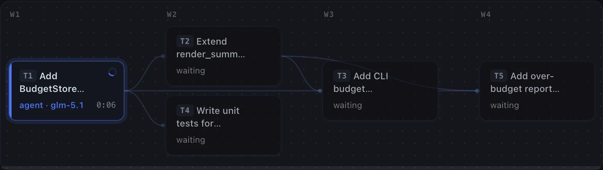
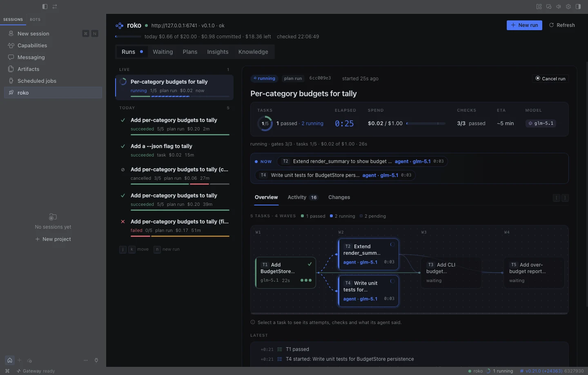
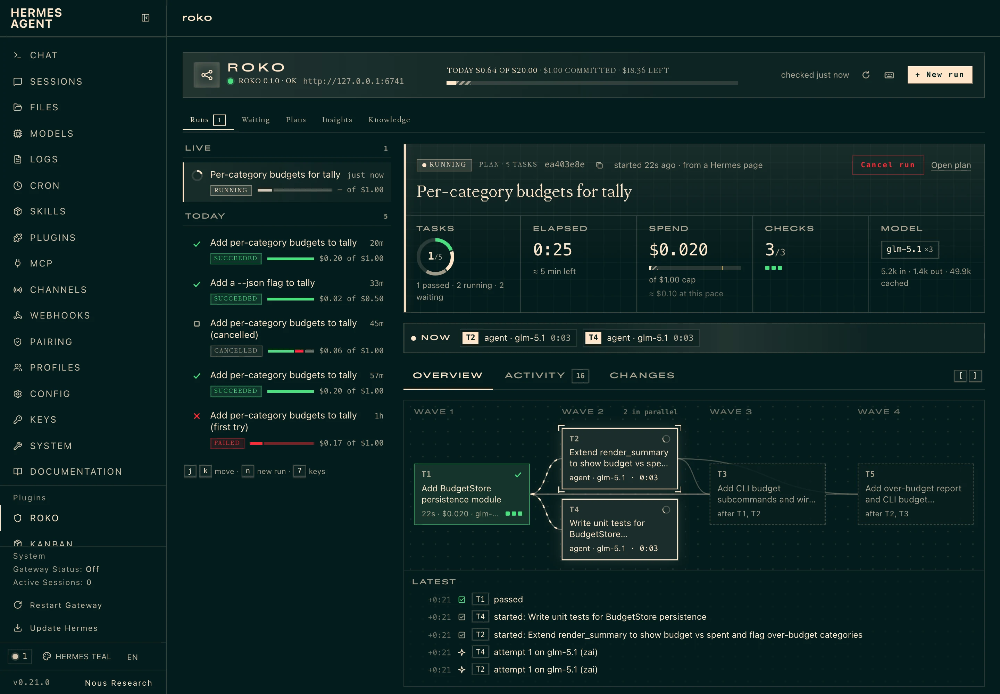
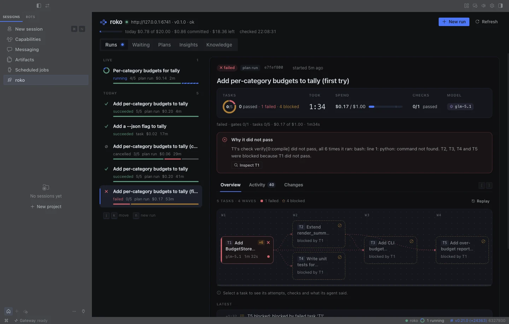
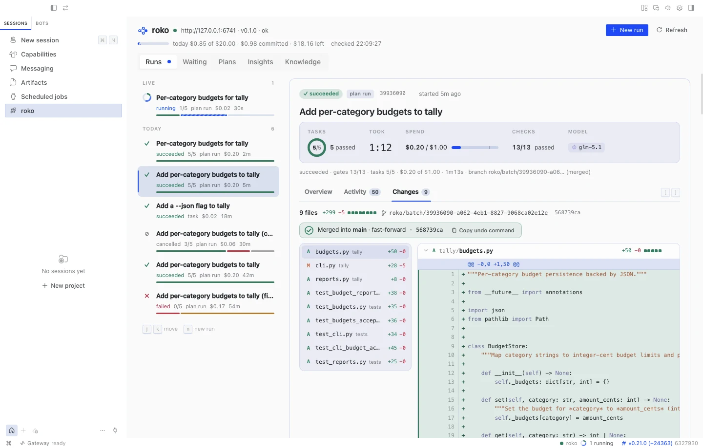
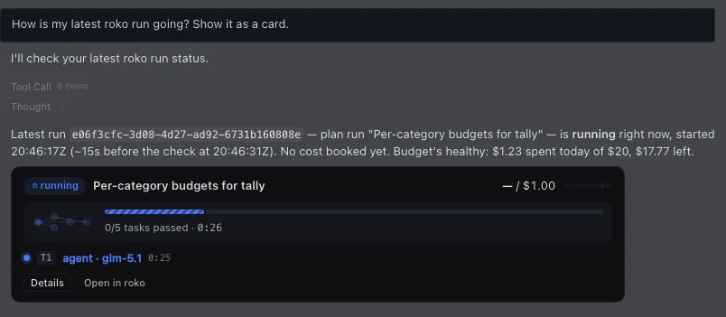

# roko for Hermes

<p align="center">
  
</p>

**Hand work from [Hermes Agent](https://github.com/NousResearch/hermes-agent) to [roko](https://github.com/wpank/roko),
watch it run as checked tasks on parallel agents under a budget, and review and merge the verified result without
leaving Hermes.**

roko turns a request into a graph of small tasks, runs each one on an agent in its own workspace, and counts a task done
only when your project's checks (build, tests, lint) pass. This plugin makes that a first-class part of Hermes: the model
delegates through eight `roko_*` tools, and every Hermes surface shows the work as it happens, in the desktop app, the
web dashboard, the terminal and every chat platform.

<table>
  <tr>
    <td></td>
    <td></td>
  </tr>
  <tr>
    <td align="center"><sub>Desktop app: a plan mid-flight</sub></td>
    <td align="center"><sub>Web dashboard: the same run</sub></td>
  </tr>
</table>

**New here?** [Getting started](docs/getting-started.md) takes about ten minutes: install, connect, first run. The
[docs](docs/README.md) have everyday use with examples, a reference and troubleshooting.

## A tour

**Ask.** In any Hermes chat ("Use roko to add a `--json` flag to the CLI, with a test. Cap it at $0.50.") or from the
**New run** composer in the app (⌘⌥R anywhere, `n` on the roko page). Run it as one checked task, or have roko's
planner write a plan first. Every run names a spending cap; the plugin checks it, and a daily limit, before roko sees
the request.

**Watch.** The run is a graph: one column per wave of tasks that can run together, each task moving through its agent
and its checks, with retries, blocks and the model on every node. Above it, live instruments (tasks passed, a ticking
clock, spend against the cap with a projection, checks, roko's estimate of the time left) and a **now** line saying
what each running task is doing. Click a task for every attempt, every check, and what its agent said.

**Know why.** A run that does not pass says why in one paragraph, from roko's own events, with the line of the failing
check that matters:

<p align="center"></p>

**Review and merge.** A finished run's **Changes** tab is its diff, file by file. **Merge** takes exactly the commit you
reviewed into your checked-out branch, as a fast-forward or a clean merge commit, after checking the checkout is
clean and nothing conflicts; it shows the command that undoes it.

<p align="center"></p>

**Stay in the conversation.** Ask Hermes how a run is going and it answers with a live card in the chat: a small graph,
progress, the current step, and Review & merge once it ends. Replay a finished run to see how it went, step by step.

<p align="center"></p>

## What it adds to Hermes

| Surface | What you get |
|---|---|
| **Desktop app** | A **roko** page: runs with mission control (instruments, graph, now line, task inspector, activity, replay, Changes and Merge), Waiting, Plans (as graphs), Insights (charts) and Knowledge. A New run composer (⌘⌥R, palette, `n`), a status-bar chip with a progress ring, notifications when a run ends or something waits on you, live chat cards (`::roko-run{id}`, `::roko-plan{id}`, `::roko-pending{run}`), and `hermes://open/roko?run=<id>` |
| **Web dashboard** | The same mission control as a **roko** tab, in the dashboard's own look and down to phone width, plus a header chip and a Sessions-page banner while runs are active |
| **Terminal** | `hermes roko watch [RUN]`: a run live, full screen; `/roko …` in the TUI; `@roko:last` puts a run's card into a message |
| **Telegram, Discord, Slack, …** | `/roko …`, with 6-character codes to approve or reject what a run waits on |
| **The model** | Eight tools (below), a short system-prompt section, three skills (`roko:delegate`, `roko:plan`, `roko:decide`) |

**Eight tools** (toolset `roko`):

| Tool | What it does | Cost and approval |
|---|---|---|
| `roko_run` | One piece of work as a single checked task; `title` names it in lists | paid; asks the person first |
| `roko_plan_generate` | roko's planner writes a plan: a graph of small checked tasks | paid; asks first |
| `roko_plan_run` | Runs a plan, or queues it behind the run in progress | paid; asks first |
| `roko_status` | A run's headline, state, verdict, cost against its cap, checks, tasks, what waits on the person (each item with a 6-character code), and where the verified work is. `detail: "tasks"` adds each task's model, attempts and checks; `detail: "why"` explains a run that did not pass. `run_id: "last"` names the latest run. Waits up to 5 minutes, and answers as soon as the state changes or something starts waiting. Without a run id: roko's health, the runs Hermes started, today's spend, and everything waiting | free |
| `roko_cancel` | Stops a running or queued run | free |
| `roko_plans` | Lists plans, or one plan's tasks, checks, waves and roko's estimate | free |
| `roko_recall` | Searches what roko's verified runs learned about the project | free |
| `roko_decide` | Records the person's own answer to something a run waits on: a result to sign off, or an outbound action (send, post, payment) roko held | asks the person first, always |

**`/roko`**, the person's own view in every chat: `status [RUN|last] [why]`, `runs`, `plans [PLAN]`, `pending`,
`approve CODE [NOTE]`, `reject CODE [NOTE]`, `cancel RUN|last`, `cost`, `gates`, `learn`, `effects`,
`knowledge QUERY` and `doctor`. Replies fit one Discord or Telegram message.

## Install

You need roko serve (roko 2026-10-13 or later; older versions work with fewer live details) and Hermes 0.21.0 or later.

```bash
cd ~/code/my-project && roko init           # set [serve.mcp] allow_without_data_llm = true in roko.toml
roko serve                                  # leave it running
hermes plugins install file:///abs/path/to/hermes-plugin-roko --enable
hermes roko setup --workdir ~/code/my-project --mint
hermes                                      # "Use roko to … Cap it at $1."
```

Then, for the desktop page: quit and reopen the desktop app (its backend loads plugin routes when it starts), turn
**roko** on in Settings ▸ Plugins ▸ Desktop plugins, and press ⌘R. For the web dashboard, restart `hermes dashboard`.
[Getting started](docs/getting-started.md) walks through each step, including giving roko an API model, which runs
started from a chat need.

## How it works

```
you ─► Hermes ─► roko_* tools ──────────► roko serve (/mcp) ─► agents in roko's workspace
         │                                    │                   checks: build, tests, lint
         │   desktop page, dashboard tab ─► /api/plugins/roko ─► run cards, diff, merge
         ◄──────────── verdict · cost · where the work is · what waits on you ◄┘
```

- **The tools** call roko serve's `/mcp` contract, which gives runs started from a chat roko's chat-host protections:
  a required cap, the request fenced as untrusted text, and outbound actions held for the person.
- **The pages** call the plugin's own routes under `/api/plugins/roko` ([docs/ui-api.md](docs/ui-api.md)), which Hermes
  authenticates like the rest of its API. roko's key stays in Hermes' backend.
- **Run cards** are folded from roko's event index, incrementally: tasks, attempts, checks, cost and tokens, timing,
  each task's current step and its agent's latest note. A finished run's card is read once and kept.
- **The work** stays on its own branch, `roko/batch/<run>`. roko never commits into your checked-out branch; you review
  the diff and merge it, from the page or with the command the card shows.

## Settings

Under `plugins.entries.roko.settings` in `~/.hermes/config.yaml`; set one with
`hermes config set plugins.entries.roko.settings.<key> <value>`. They apply without a restart.

| Key | Default | Meaning |
|---|---|---|
| `url` | `http://127.0.0.1:6677` | roko serve's URL (`ROKO_URL` overrides it; otherwise `<workdir>/.roko/runtime/serve.json`) |
| `workdir` | unset | the roko workspace: lets the plugin find the URL and launch token, read result branches and merge |
| `api_key_env` | `ROKO_API_KEY` | the environment variable that holds the key |
| `max_run_usd` | `5.0` | the largest cap a run started from Hermes may name |
| `max_day_usd` | `20.0` | the most the runs Hermes starts may spend in a day, counting what running ones may still spend; `0` turns it off |
| `approve_paid` | `true` | ask the person before `roko_run`, `roko_plan_generate` and `roko_plan_run` |
| `confirm_decisions` | `true` | ask the person before `roko_decide` records an answer |
| `prompt_section` | `true` | add the `roko` section to new sessions' system prompt |
| `allow_insecure_remote` | `false` | allow sending the key over plain `http` to a non-loopback host |
| `timeout_s` | `20` | seconds to wait for roko serve to answer one request |
| `ui_actions` | `true` | let the desktop app and dashboard start runs, answer held items, cancel and merge; `false` makes them read-only |

## Safety

- **Text from roko is cleaned and shown as text.** Labels, notes, summaries, check output and diff lines are written by
  agents, so escape sequences, control characters and bidirectional overrides are removed before they reach a terminal,
  an approval prompt, a chat or a page, and the pages render them as text nodes only: never HTML, never markdown.
- **The person approves spending.** Paid tools go through Hermes' own approval gate (in the terminal, the box with Allow
  once, Allow for this session, Add to permanent allowlist and Deny; unanswered, it denies after 5 minutes). An "always"
  answer covers the same kind of work at the same cap, never a larger one. A click in a Hermes page is the person acting:
  it asks no second question, but a paid start still confirms its cap, and the run cap and daily limit still apply.
- **Merge is guarded.** It merges only the run's own batch branch, at the commit the person reviewed (if the branch moved,
  nothing is merged), only when roko's workspace is a local git checkout on a branch with no merge or rebase in progress
  and no uncommitted changes to tracked files, and only as a fast-forward or a merge `git merge-tree` showed to be clean.
  Anything else is refused with the command to run by hand. A merge git stops half way is aborted.
- **The person decides what a run waits on.** `roko_decide` answers only what roko still waits on, shows the person what
  it is, and binds the approval to that item and that verdict. `/roko approve` and the page's buttons come from the person.
- **Slow answers are not reported as failures.** A timed-out paid start is looked for before anything is retried, and a
  slow decision says it may already be recorded.
- **The key** is write-scoped, stored in `~/.hermes/.env`, sent as `X-Api-Key`, never written to `config.yaml` or
  printed, and never sent over plain `http` to another host unless you allow it.
- **Approvals are advisory against a model that has a shell.** Hermes does not strip `ROKO_API_KEY` from the shells its
  model runs (checked on 0.21.0), so a prompt-injected model with the terminal tool could call roko serve directly. roko's
  own `[serve.mcp] max_run_usd` and its untrusted-text fence still hold. Run Hermes without the terminal tool for
  sessions that can reach roko if that matters to you, or keep `max_run_usd` low.

## Troubleshooting

`hermes roko doctor` (or `/roko doctor`) checks every link (reachable, auth, key scope, the `/mcp` tools, whether roko
accepts chat-started runs, which UI halves are installed) and says what to fix. [Troubleshooting](docs/troubleshooting.md)
covers the rest, including a desktop page that shows the home screen, runs that fail at once because roko's model is a
CLI agent, and what each Merge refusal means.

## Development

```bash
uv venv --python 3.11 .venv && uv pip install -e '.[dev]'
.venv/bin/ruff check . && .venv/bin/ruff format --check . && .venv/bin/mypy
.venv/bin/pytest                                         # everything below that this machine can run
ROKO_BIN=/path/to/roko .venv/bin/pytest tests/contract   # against a real roko serve, at no model cost
```

- **Unit** (`tests/test_*.py`): a strict fake `PluginContext` and `tests/fake_roko.py`, a stdlib stand-in for roko serve
  that reproduces its envelopes, caps, refusals and auth. Card tests fold the event indexes of real runs recorded in the
  Hermes dogfood (`tests/fixtures/dogfood_runs.json`).
- **Replay roko** (`tests/replay_roko.py`): a roko serve that plays those recorded runs back over time, with each row's
  time moved to now, takes new work by replaying more, holds a sign-off for an answer, and keeps a git workspace whose
  branches Merge can take. Point a scratch Hermes at it to build or demo the pages without spending anything:
  `python tests/replay_roko.py --port 6720 --speed 6 --seed <hermes home> --workdir <dir>`.
- **Compat** (`tests/compat`): loads the plugin into the installed Hermes through its own plugin manager, tool registry,
  command resolver, prompt renderer, web server and install scanner.
- **Contract** (`tests/contract`): a real `roko serve` with auth on, in a scratch workspace and `HOME`.
- **Desktop** (`tests/desktop`): `desktop/plugin.js` through the real Hermes desktop loader, SDK and React, with vitest
  (`bash tests/desktop/setup.sh` first).
- **Dashboard** (`tests/dashboard`): `dashboard/dist/index.js` in jsdom with a fake dashboard SDK, on fixtures that are
  the backend's own answers about the recorded runs (`tests/dashboard/make_fixtures.py`).

## Compatibility

Tested with Hermes Agent 0.21.0 on Python 3.11, its desktop app's plugin SDK and its dashboard's plugin SDK, and roko
at `1e3419a51` (2026-10-13). The plugin needs roko's MCP tools `run_status`, `recall`, `run_prompt`, `plan_run`,
`plan_generate`, `run_cancel`, `confirm_pending`, `confirm_answer`, `effects_pending` and `effect_decide`; the diff view
needs `GET /api/runs/{id}/diff` (an older roko serve falls back to reading the branch with git). `hermes roko doctor`
reports what is missing.

## License

MIT OR Apache-2.0, at your option.
