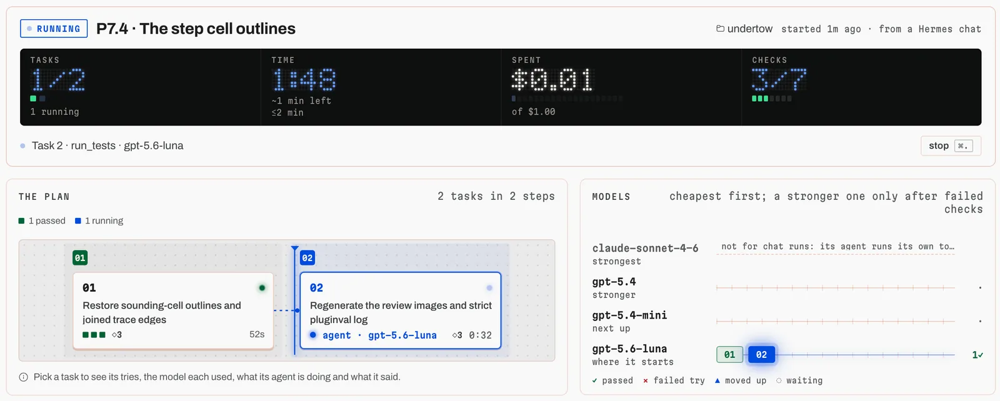
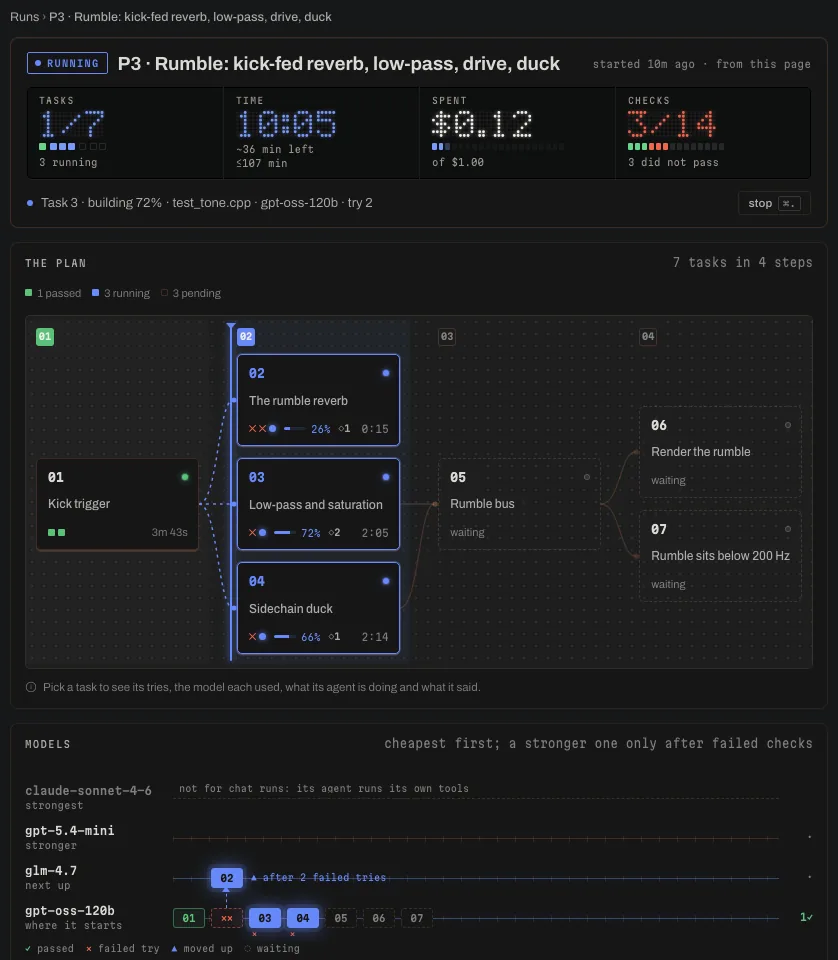
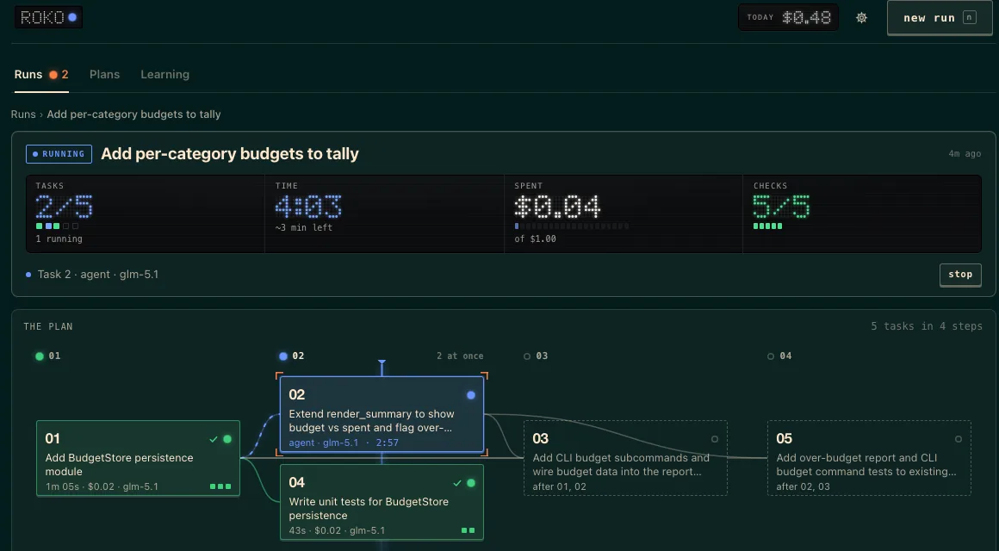
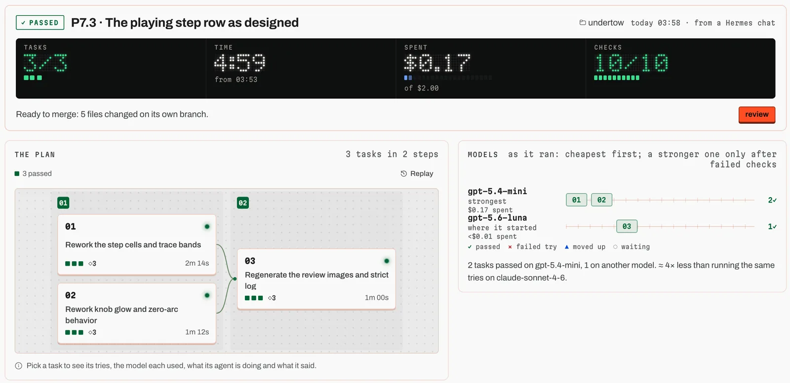
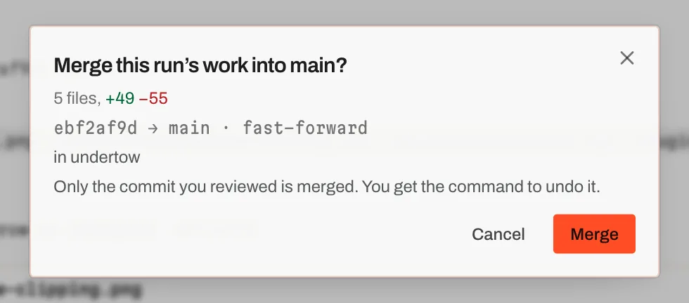
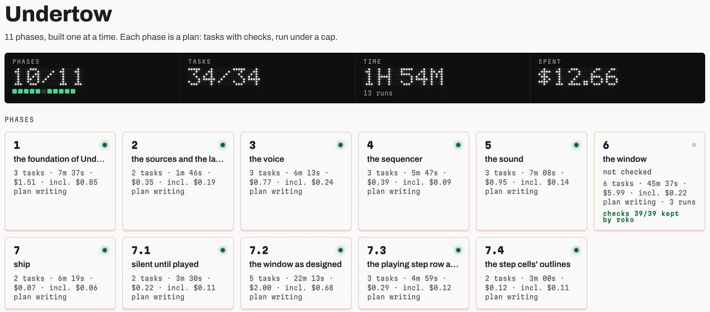

# roko for Hermes

<p align="center">
  
</p>

**Hand work from [Hermes Agent](https://github.com/NousResearch/hermes-agent) to [roko](https://github.com/wpank/roko),
watch it run live as checked tasks on parallel agents under a budget, see roko's feedback loops work as they work, and
review and merge the verified result without leaving Hermes.**

roko turns a request into a graph of small tasks, runs each one on an agent in its own workspace, and counts a task done
only when your project's checks (build, tests, lint) pass. It regulates itself on five nested loops: each tool call,
each try, the plan, what it learns, and an audit of the loops themselves. This plugin makes all of that a
first-class part of Hermes. The model delegates through eight `roko_*` tools, and every Hermes surface shows the work
as it happens: the desktop app, the web dashboard, the terminal and every chat platform.

<table>
  <tr>
    <td></td>
    <td></td>
  </tr>
  <tr>
    <td align="center"><sub>Desktop app, at night in the <code>roko</code> theme</sub></td>
    <td align="center"><sub>Web dashboard: the same page in its own look</sub></td>
  </tr>
</table>

**New here?** [Getting started](docs/getting-started.md) takes about five minutes: install, `hermes roko init`, the demo. The
[docs](docs/README.md) have everyday use with examples, a reference and troubleshooting.

## A tour

roko has its own page in Hermes, in the desktop app and in the web dashboard, with three tabs: **Runs**, **Plans** and
**Learning**. Numbers sit on black glass in roko's dot-matrix face. Four colours carry meaning and nothing else: blue
while roko works, green when a check passed, red when one did not, and orange for you, either something that waits on
your answer or the one key to press next. Each view has at most one orange key.

**Ask.** In any Hermes chat: "Use roko to add a `--json` flag to the report command, with a test. Cap it at $0.50."
Or press `n` on the roko page for **New run**: say what you want done, run it at once or have roko write a plan
first, and pick the cap. A sentence under the cap says what will happen when you press start: once roko can estimate
the work, what it expects to spend, and that the cap stops it before it spends past it.

<p align="center"></p>

**Watch it.** A run is a page. Its head says what is happening in one sentence, under four readings on the glass:
how many tasks passed, with the plan drawn as a strip; the time, with what is left; what it spent, against its cap;
and how many checks passed. Below, the plan runs step by step, a pad per task, beside the models it used: the
cheapest first, and a stronger one only for a task whose checks failed twice. What the agents are doing, every step
and where the time went are folded under it.

**Look inside a task.** Click a pad: its tries, the model each one used and why it moved up, what its agent is doing
now, and what its checks printed.

<p align="center"></p>

**Answer what waits on you.** When a run needs your sign-off, it stops until you decide, and the question comes first
on Runs. Its card shows the work and two keys, **decline** and **approve**: a decline fails the check with your note,
and the task's next try gets it.

**Review and merge.** When a run passes, its one orange key is **review**. It opens the changes, file by file, and
merge sits there: it asks first, takes exactly the commit you reviewed into your branch, and shows the command that
undoes it. A merged run says where its work went.

<p align="center"></p>

<p align="center"></p>

**Plans.** A project built in phases gets its build at the top of Plans: the phases on the glass, what to do next in
one sentence with its key, and a pad per phase. Every plan has a line, and each plan has its own page.

<p align="center"></p>

<p align="center"><sub>Phase 6 reads <b>not checked</b> because its last fix ran its checks inside its own try, which roko does not count, although the merged work passed every check.</sub></p>

**Learning.** Is roko getting better at your project? Three readings answer it: what a passed task costs, how often a
task passes on its first try, and how often a task moves up to a stronger model. Below them, which models did the
work and the lessons that paid off. How roko's loops work, how it keeps itself steady, every lesson and the checks'
figures are folded under them.

<p align="center"></p>

**Stay in the conversation.** In a chat, the run is a card with the same head as its page, and it moves while the run
does. A side pane beside the chat follows the newest run, and the status bar shows roko's most urgent state.

<table>
  <tr>
    <td valign="top"></td>
    <td valign="top" width="300"></td>
  </tr>
</table>

**In the web dashboard** the same pages take the dashboard's own look, down to phone width. A chip in its header says
roko's most urgent state, and one line above the chat and the sessions list follows a run while it goes.

<p align="center"></p>

## What it adds to Hermes

| Surface | What you get |
|---|---|
| **Desktop app** | A **roko** page with three tabs (Runs, Plans, Learning): a run is its own page, with its readings, the plan beside its models, a task's tries and checks, what it made and learned, and its changes with merge. **New run** (⌘⌥R, the palette, `n`, or the `→ roko` key in the chat composer). A **side pane** in the right sidebar that follows the newest run. Run cards in the chat (`::roko-run{id}`, `::roko-plan{id}`, `::roko-pending{run}`). A **delegate to roko** card in an empty chat that already has a session. A **`roko` theme** (aluminium by day, graphite by night) for the whole app. roko's **settings page** under Settings ▸ Plugins ▸ roko. A light on the sidebar row of a chat whose run is going, a status-bar chip, notifications, pet lines, opt-in sounds, and `hermes://open/roko?run=<id>` |
| **Web dashboard** | The same pages as a **roko** tab, down to phone width; a chip in the header with roko's most urgent state, and one line above the chat and on Sessions while a run goes or something waits on you |
| **Terminal** | `hermes roko init`: a project ready in one command; `hermes roko watch [RUN]`: a run live, full screen; `hermes roko serve` and `hermes roko projects`: each project's roko serve, and the projects; `/roko …` in the TUI; `@roko:last` puts a run's card into a message |
| **Telegram, Discord, Slack, …** | `/roko …`, with 6-character codes to approve or reject what a run waits on |
| **The model** | Eight tools (below), a short system-prompt section, three skills (`roko:delegate`, `roko:plan`, `roko:decide`) |

**Eight tools** (toolset `roko`):

| Tool | What it does | Cost and approval |
|---|---|---|
| `roko_run` | One piece of work as a single checked task; `title` names it in lists | paid; asks the person first |
| `roko_plan_generate` | roko's planner writes a plan: a graph of small checked tasks | paid; asks first |
| `roko_plan_run` | Runs a plan, or queues it behind the run in progress | paid; asks first |
| `roko_status` | A run's headline, state, verdict, cost against its cap, checks, tasks, what waits on the person (each item with a 6-character code), and where the verified work is. `detail: "tasks"` adds each task's model, tries and checks; `detail: "why"` explains a run that did not pass. `run_id: "last"` names the latest run. Waits up to 5 minutes, and answers as soon as the state changes or something starts waiting. Without a run id: one project's overview, the chat's unless the call names another: roko's health, the project's recent runs (those Hermes started and those started elsewhere, such as from roko's CLI), today's spend, and everything waiting. A run Hermes did not start is looked up in the chat's project, then in every project Hermes knows | free |
| `roko_cancel` | Stops a running or queued run | free |
| `roko_plans` | Lists plans, or one plan's tasks, checks, steps and roko's estimate | free |
| `roko_recall` | Searches what roko's verified runs learned about the project | free |
| `roko_decide` | Records the person's own answer to something a run waits on: a result to sign off, or an outbound action (send, post, payment) roko held | asks the person first, always |

**`/roko`**, the person's own view in every chat: `status [RUN|last] [why]`, `runs`, `plans [PLAN]`, `pending`,
`approve CODE [NOTE]`, `reject CODE [NOTE]`, `cancel RUN|last`, `cost`, `gates`, `learn`, `effects`,
`knowledge QUERY` and `doctor`. Replies fit one Discord or Telegram message.

## Install

You need roko (`cargo install --path crates/roko-cli` in a clone of roko's repository), recent enough to start roko
serve in the background (`roko serve --detach`, roko 2026-10-19 or later), and Hermes Agent 0.21.6 or later (tested
with 0.22.0). The live loop events (routes, sign-off waits, held calls, lessons) need roko 2026-10-14 or later.

**Hermes starts roko by itself.** Each project gets its own `roko serve`, on its own port, started in the background
when the desktop app opens, when the roko page shows a project, or when a chat first uses roko. It keeps running after
Hermes quits, so runs in flight finish, and stops by itself after an idle hour. You pick the project per run: the
page's project switcher, a folder picker in the composer, or a chat that names one.

```bash
hermes plugins install https://github.com/wpank/hermes-plugin-roko --enable
cd ~/code/my-project && hermes roko init    # roko's key, roko.toml, roko serve, the connection, a demo
hermes                                      # "Use roko to run the demo-hello-world plan. Cap it at $0.25."
```

`hermes roko init` goes through everything a project needs and asks before each change: a key for an API model in
`~/.roko/.env` (it offers the one Hermes has), `roko init`, roko serve in the background, the project as Hermes'
default project, the one-line change to `roko.toml` that lets runs from Hermes through, an API model when roko has none,
roko's learning (recommended: the prompt section that carries lessons is never dropped), committing `roko.toml` when git
tracks it, and a hello-world demo plan. Run it again any time: it changes only what is missing (`--dry-run` only
looks, `--yes` answers for you). `hermes roko fix` lists anything still in the way, and the
roko page shows the same as a setup card with a key per fix.

Then, for the desktop page: turn on roko's **Desktop** switch in Capabilities ▸ Plugins (if the app was open during
the install, quit it with ⌘Q and open it again first). For the web dashboard, restart `hermes dashboard`. To watch the
agent's words stream while it works, change `live_agent_output` in `roko.toml`'s `[serve]` section to `"trusted"` (it
takes effect when roko serve listens on loopback only). [Getting started](docs/getting-started.md) walks through each
step, and does them by hand too.

**Updating:** `hermes plugins update roko`, then quit Hermes (⌘Q) and open it again, or restart `hermes dashboard`:
Hermes keeps running the version it started with until then. See [Updating](docs/updating.md).

## How it works

```
you ─► Hermes ─► roko_* tools ─────────────────► roko serve (/mcp) ─► agents in roko's workspace
         │            one per project, started  ▲  │  checks: build, tests, lint
         │            by the plugin when needed ┘  │  events: GET /api/events (server-sent, as they happen)
         │   desktop page, dashboard tab, chat ◄── WS /api/plugins/roko/live ◄── the plugin's live relay
         │                                     ◄── REST /api/plugins/roko/* (cards, diff, merge, loops)
         ◄──────────── verdict · cost · where the work is · what waits on you
```

- **roko serve, one per project.** The plugin finds roko (the `roko_bin` setting, `ROKO_BIN`, `~/.roko/bin`, `PATH`,
  `~/.cargo/bin`) and starts a project's serve only with `roko serve --detach --json`, under a lock every Hermes
  process shares, so the desktop app, a chat and the terminal never start two. It never kills one: it stops and
  restarts one only through `roko serve stop` and `restart`, which leave a serve with runs going alone unless you
  confirm. A project's address comes from the `serve.json` its serve writes; Hermes talks to it with the project's
  launch token. A `url` setting on another machine pins that one serve instead, and the plugin starts nothing.

- **The tools** call roko serve's `/mcp` contract, which gives runs started from a chat roko's chat-host protections:
  a required cap, the request fenced as untrusted text, and outbound actions held for the person.
- **The live relay** (one per Hermes backend process) follows roko's event hub and pushes, to every open page, the
  agent's tool steps and words, the loop events, new timeline lines and rebuilt cards. Under `hermes serve` it also
  raises Hermes plugin events (a run started, ended, waits on you), so the desktop app hears of them with no roko page
  open. Without the hub (an older roko) the relay re-reads active runs every 3 s and the frames keep their shape.
- **The pages** call the plugin's own routes under `/api/plugins/roko` ([docs/ui-api.md](docs/ui-api.md)), which Hermes
  authenticates like the rest of its API, and open the live socket with Hermes' own socket credential. roko's key
  stays in Hermes' backend.
- **Run cards** are folded from roko's event index, incrementally: tasks, tries and their routes, checks, cost and
  tokens, timing, each task's current step, tool steps, sign-offs, held calls and lessons, and the run's loop events.
  A finished run's card is read once and kept.
- **The work** stays on its own branch, `roko/work/<plan>`, the branch roko reports. roko never commits into your
  checked-out branch; you review the diff and merge it, from the page or with the command the card shows.

## Settings

Under `plugins.entries.roko.settings` in `~/.hermes/config.yaml`; set one with
`hermes config set plugins.entries.roko.settings.<key> <value>`. They apply without a restart.

| Key | Default | Meaning |
|---|---|---|
| `url` | unset | only for a roko serve on another machine: the plugin uses that one and starts nothing (`ROKO_URL` does the same). On this machine each project's `.roko/runtime/serve.json` says where its serve listens |
| `workdir` | unset | the default project: a git checkout roko works in (`hermes roko init` fills it in) |
| `auto_start` | `true` | start a project's roko serve when Hermes needs it; off: only Start (page) and `hermes roko serve start` do |
| `roko_bin` | `""` | the roko binary; empty: find it |
| `idle_exit_minutes` | `60` | a roko serve Hermes started stops by itself after this many idle minutes; `0`: never |
| `api_key_env` | `ROKO_API_KEY` | the environment variable that holds the key for a remote roko serve (a local project's launch token comes first) |
| `max_run_usd` | `5.0` | the largest cap a run started from Hermes may name |
| `max_day_usd` | `20.0` | the most the runs Hermes starts may spend in a day, counting what running ones may still spend; `0` turns it off |
| `approve_paid` | `true` | ask the person before `roko_run`, `roko_plan_generate` and `roko_plan_run` |
| `confirm_decisions` | `true` | ask the person before `roko_decide` records an answer |
| `prompt_section` | `true` | add the `roko` section to new sessions' system prompt |
| `allow_insecure_remote` | `false` | allow sending the key over plain `http` to a non-loopback host |
| `timeout_s` | `20` | seconds to wait for roko serve to answer one request |
| `ui_actions` | `true` | let the desktop app and dashboard start runs, answer held items, cancel and merge; `false` makes them read-only |
| `learning_guard` | `false` | opt-in: refuse Hermes' background review a skill or memory that teaches repairing roko's state or re-running paid roko work (Hermes 0.22+; takes effect when Hermes restarts) |

The pages keep one preference of their own: sounds, off until you turn them on in roko's settings. The `roko` theme
is a Hermes theme like any other: pick it in Settings ▸ Appearance, or with **use the roko theme** on the settings
page.

## Safety

- **Text from roko is cleaned and shown as text.** Labels, notes, the agent's live words, summaries, check output and
  diff lines are written by agents, so escape sequences, control characters and bidirectional overrides are removed
  before they reach a terminal, an approval prompt, a chat, a socket frame or a page, and the pages render them as text
  nodes only: never HTML, never markdown.
- **The live socket checks Hermes' own credential** before it accepts a connection (the check Hermes' chat sockets
  use), and refuses when that check is missing. Pages only receive on it.
- **The person approves spending.** Paid tools go through Hermes' own approval prompt (in the terminal, the box with Allow
  once, Allow for this session, Add to permanent allowlist and Deny; unanswered, it denies after 5 minutes). An "always"
  answer covers the same kind of work at the same cap, never a larger one. A click in a Hermes page is the person acting:
  it asks no second question, but a paid start still shows its cap first, and the run cap and daily limit still apply.
- **Merge is guarded.** It merges only the run's own branch, at the commit the person reviewed (if the branch moved,
  nothing is merged), only when roko's workspace is a local git checkout on a branch with no merge or rebase in progress
  and no uncommitted changes to tracked files, and only as a fast-forward or a merge `git merge-tree` showed to be clean.
  Anything else is refused with the command to run by hand. A merge git stops half way is aborted.
- **The person decides what a run waits on.** `roko_decide` answers only what roko still waits on, shows the person what
  it is, and binds the approval to that item and that verdict. `/roko approve` and the page's keys come from the person.
- **Slow answers are not reported as failures.** A timed-out paid start is looked for before anything is retried, and a
  slow decision says it may already be recorded.
- **The key** is write-scoped, stored in `~/.hermes/.env`, sent as `X-Api-Key`, never written to `config.yaml` or
  printed, and never sent over plain `http` to another machine unless you allow it. On this machine the plugin sends a
  project's launch token instead (roko serve writes it, mode 0600, at every start), read afresh for each client.
- **roko serve is started with a clean environment.** The plugin passes roko its own environment minus the keys
  Hermes holds (Hermes' `.env` and the model keys roko reads from `~/.roko/.env`), never its own pipes, and never
  starts anything when Hermes loads the plugin.
- **Unscreened words stay local.** `live_agent_output = "trusted"` streams the agent's words before roko's output
  screening, and roko honours it only on a loopback bind; the card's transcript is the screened one.
- **Approvals are advisory against a model that has a shell.** Hermes does not strip `ROKO_API_KEY` from the shells its
  model runs, so a prompt-injected model with the terminal tool could call roko serve directly. roko's own
  `[serve.mcp] max_run_usd` and its untrusted-text fence still hold. Run Hermes without the terminal tool for sessions
  that can reach roko if that matters to you, or keep `max_run_usd` low.

## Troubleshooting

`hermes roko doctor` (or `/roko doctor`, or the doctor's checks on the settings page) checks every link (the project and
its roko serve, reachable, auth, key scope, the `/mcp` tools, whether roko accepts chat-started runs and has a model
for them, whether Hermes runs the plugin it has installed, which UI halves are installed) and says what to fix, in the
same words as the roko page's setup card. `hermes roko fix` makes the one fix the plugin can make itself: it shows the
change to `roko.toml`, then asks, and `hermes roko init` runs every setup step again, changing only what is missing.
[Troubleshooting](docs/troubleshooting.md) covers the rest, including a desktop page that shows the home screen, runs
that fail at once because roko's model is a CLI agent, a page whose live light is out, and what each merge refusal
means.

## Development

```bash
uv venv --python 3.11 .venv && uv pip install -e '.[dev]'
.venv/bin/ruff check . && .venv/bin/ruff format --check . && .venv/bin/mypy
.venv/bin/pytest                                         # everything below that this machine can run
ROKO_BIN=/path/to/roko .venv/bin/pytest tests/contract   # against a real roko serve, at no model cost
```

- **Unit** (`tests/test_*.py`): a strict fake `PluginContext` and `tests/fake_roko.py`, a stdlib stand-in for roko serve
  that reproduces its envelopes, caps, refusals, auth and event hub. Card and relay tests fold the event indexes of
  real runs: the Hermes dogfood's (`tests/fixtures/dogfood_runs.json`) and runs recorded from a live roko with real
  models (`tests/fixtures/live_runs.json`: every row, with the agents' words merged into stretches of up to 250 ms).
- **Replay roko** (`tests/replay_roko.py`): a roko serve that plays those recorded runs back over time, with each row's
  time moved to now, streams them on its hub, answers roko's learning routes from them, takes new work by replaying
  more, holds a sign-off for an answer, and keeps a git workspace whose branches Merge can take. Point a scratch Hermes
  at it to build or demo the pages without spending anything:
  `python tests/replay_roko.py --port 6720 --speed 6 --seed <hermes home> --workdir <dir>`. `--recording live`
  replays the live roko's runs exactly as recorded; `--tour` adds one of each loop event the recordings never show (a
  held call, a regression, a budget alert, a stall diagnosis, a guard notice, a loop changing health), marked
  `"synthetic": true` on its rows.
- **Compat** (`tests/compat`): loads the plugin into the installed Hermes through its own plugin manager, tool registry,
  command resolver, prompt renderer, web server and install scanner.
- **Contract** (`tests/contract`): a real `roko serve` with auth on, in a scratch workspace and `HOME`, including the live
  socket and `/loops` against roko's own hub.
- **Desktop** (`tests/desktop`): `desktop/plugin.js` through the real Hermes desktop loader, SDK and React, with vitest
  (`bash tests/desktop/setup.sh` first), with a fake socket for the live frames.
- **Dashboard** (`tests/dashboard`): `dashboard/dist/index.js` in jsdom with a fake dashboard SDK and a fake WebSocket, on
  fixtures that are the backend's own answers about the recorded runs (`tests/dashboard/make_fixtures.py`).

## Compatibility

Tested with Hermes Agent 0.22.0 (`0e427d788`) on Python 3.11, its desktop app's plugin SDK and its dashboard's plugin
SDK, and roko at `86d629363` (2026-10-14). The plugin needs roko's MCP tools `run_status`, `recall`, `run_prompt`,
`plan_run`, `plan_generate`, `run_cancel`, `confirm_pending`, `confirm_answer`, `effects_pending` and `effect_decide`;
the diff view needs `GET /api/runs/{id}/diff` (an older roko serve falls back to reading the branch with git); the live
channel reads `GET /api/events` (without it, pages update every few seconds instead). `hermes roko doctor` reports what
is missing.

## License

MIT OR Apache-2.0, at your option.
