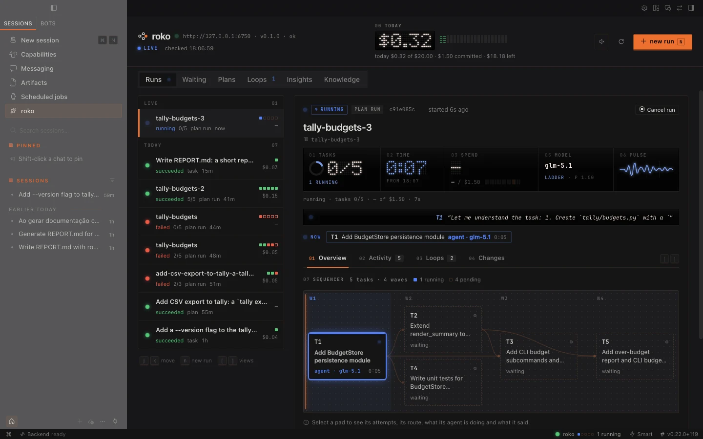
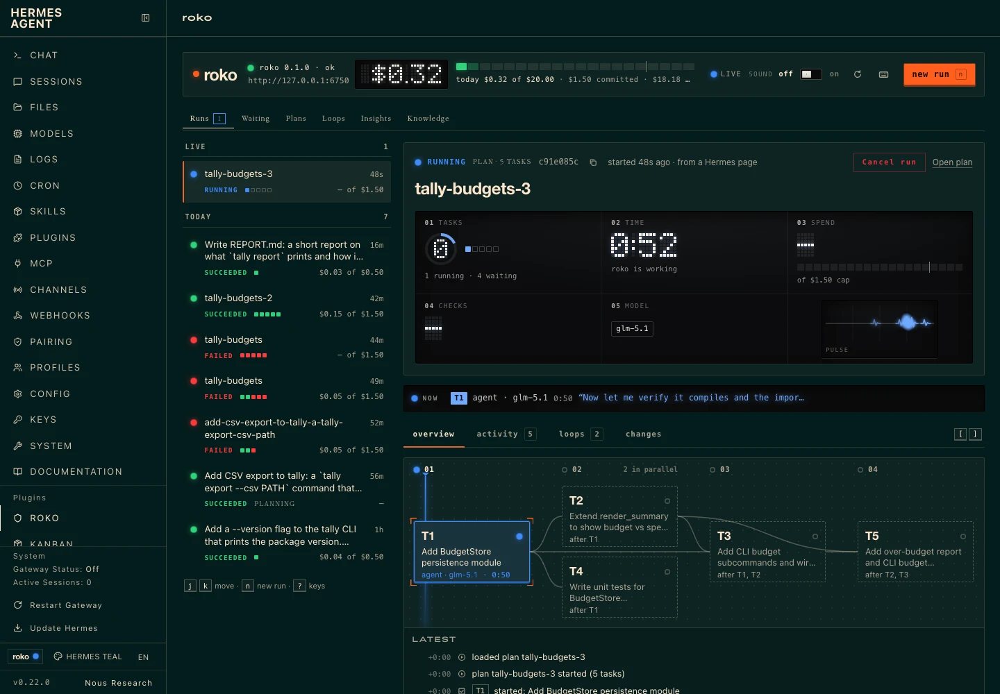
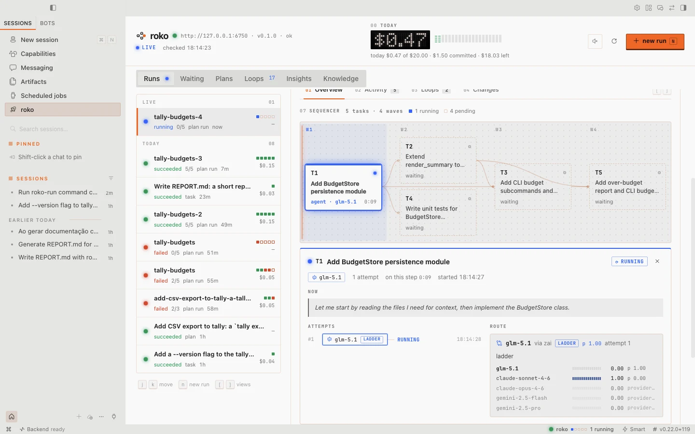
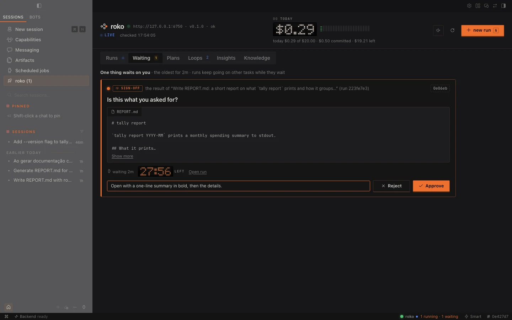
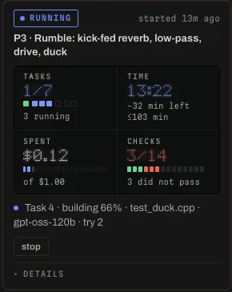
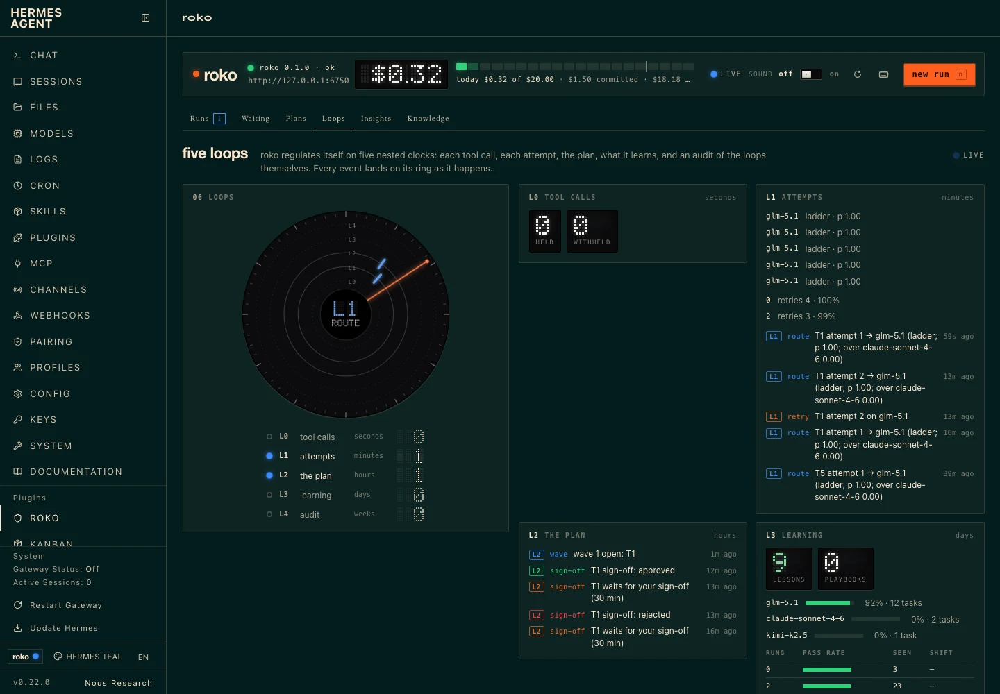

# roko for Hermes

<p align="center">
  
</p>

**Hand work from [Hermes Agent](https://github.com/NousResearch/hermes-agent) to [roko](https://github.com/wpank/roko),
watch it run live as checked tasks on parallel agents under a budget, see roko's feedback loops work as they work, and
review and merge the verified result without leaving Hermes.**

roko turns a request into a graph of small tasks, runs each one on an agent in its own workspace, and counts a task done
only when your project's checks (build, tests, lint) pass. It regulates itself on five nested loops: each tool call,
each attempt, the plan, what it learns, and an audit of the loops themselves. This plugin makes all of that a
first-class part of Hermes. The model delegates through eight `roko_*` tools, and every Hermes surface shows the work
as it happens: the desktop app, the web dashboard, the terminal and every chat platform.

<table>
  <tr>
    <td></td>
    <td></td>
  </tr>
  <tr>
    <td align="center"><sub>Desktop app: a plan mid-flight, in the <code>roko</code> theme</sub></td>
    <td align="center"><sub>Web dashboard: the same instruments in its own look</sub></td>
  </tr>
</table>

**New here?** [Getting started](docs/getting-started.md) takes about five minutes: install, `hermes roko init`, the demo. The
[docs](docs/README.md) have everyday use with examples, a reference and troubleshooting.

## A tour

The pages are a control surface. Each run is one instrument: a black display bar with dot-matrix readouts
(`01 TASKS`, `02 TIME`, `03 SPEND`, `04 CHECKS`, `05 MODEL`, `06 PULSE`), a ticker with what is happening this second,
and the tasks as pads on a sequencer, one column per wave. Four colours carry meaning and nothing else: blue is an
agent working, green is a check passed, orange is you (something waits on you, or the key that starts work), red is a
check that did not pass. A page with nothing happening is monochrome.

**Ask.** In any Hermes chat ("Use roko to add a `--json` flag to the CLI, with a test. Cap it at $0.50."), with the
`→ roko` key in the chat composer, or from **new run** (⌘⌥R anywhere, `n` on the roko page). Run it as one checked
task, or switch to **plan first**. The cap is a knob with detents that stop at your limits.

<p align="center"></p>

**Watch it live.** roko's events reach the page over a WebSocket a few milliseconds after roko publishes them: the
router's pick before each attempt, each tool step, each check, each task passing and, with roko's trusted live output
on, the agent's words as it writes them. In the end-to-end test against roko with real models (10 runs, $0.74), the median delay was 4 ms for a route,
15 to 20 ms for the agent's words and 0.3 s for a line in the activity log.

**See the loops.** The Loops tab puts roko's five loops on a dial: L0 tool calls (seconds), L1 attempts (minutes), L2
the plan (hours), L3 learning (days), L4 audit (weeks). A hand sweeps once a minute and every event drops a tick on its
ring. Beside it, each ring's latest events and roko's own state for it: the router's picks and retry budgets, waves
and sign-offs, the lessons roko kept and its check thresholds, the learning loops' health.

<p align="center"></p>

**Look inside a task.** Click a pad. The panel shows what the agent is saying now, every attempt, and why each attempt
runs on its model: roko's route, with the candidates it weighed as bars and why the others were passed over.

<p align="center"></p>

**Answer what waits on you.** A sign-off stops the run until you decide. The card shows the work, roko's own deadline
counting down on the display, and two keys. A rejection fails the check with your note, and the task's next attempt
gets the note.

<p align="center"></p>

**Review and merge.** A finished run's **Changes** tab is its diff, file by file. **Merge** takes exactly the commit you
reviewed into your checked-out branch, as a fast-forward or a clean merge commit, and shows the command that undoes it.

**Stay in the conversation.** A monitor pane beside the chat follows the newest run, and Hermes can answer "how is my
run going?" with a live card. The sidebar row of a chat whose run is going lights up; the pet says when a run ends or
needs you.

<table>
  <tr>
    <td valign="top"></td>
    <td valign="top" width="310"></td>
  </tr>
</table>

**In the web dashboard** the same instruments live in the dashboard's own look, and roko also appears on its other
pages: a strip above the chat while a run is going, a summary card on Analytics, a scorecard on Models, a strip on
Sessions and a chip in the sidebar.

<p align="center"></p>

## What it adds to Hermes

| Surface | What you get |
|---|---|
| **Desktop app** | A **roko** page (Runs, Waiting, Plans, Loops, Insights, Knowledge) with each run as an instrument: the display bar, the ticker, the sequencer, the task panel with routes, Activity, Loops, Replay, Changes and Merge. **new run** (⌘⌥R, the palette, `n`, or the `→ roko` key in the chat composer). A **monitor pane** in the right sidebar. A **delegate to roko** card in an empty chat that already has a session (in a new chat, the `→ roko` key beside the model pill does the same). A **`roko` theme** (aluminium by day, graphite by night, TE orange) for the whole app. A **settings page** under Settings ▸ Plugins ▸ roko. A light on the sidebar row of a chat whose run is going. A status-bar chip, notifications, pet lines, opt-in sounds, live chat cards (`::roko-run{id}`, `::roko-plan{id}`, `::roko-pending{run}`), and `hermes://open/roko?run=<id>` |
| **Web dashboard** | The same instruments as a **roko** tab, down to phone width, plus a sidebar chip, a strip above the chat and on Sessions while a run is going, a summary card on Analytics and a scorecard on Models |
| **Terminal** | `hermes roko init`: a project ready in one command; `hermes roko watch [RUN]`: a run live, full screen; `/roko …` in the TUI; `@roko:last` puts a run's card into a message |
| **Telegram, Discord, Slack, …** | `/roko …`, with 6-character codes to approve or reject what a run waits on |
| **The model** | Eight tools (below), a short system-prompt section, three skills (`roko:delegate`, `roko:plan`, `roko:decide`) |

**Eight tools** (toolset `roko`):

| Tool | What it does | Cost and approval |
|---|---|---|
| `roko_run` | One piece of work as a single checked task; `title` names it in lists | paid; asks the person first |
| `roko_plan_generate` | roko's planner writes a plan: a graph of small checked tasks | paid; asks first |
| `roko_plan_run` | Runs a plan, or queues it behind the run in progress | paid; asks first |
| `roko_status` | A run's headline, state, verdict, cost against its cap, checks, tasks, what waits on the person (each item with a 6-character code), and where the verified work is. `detail: "tasks"` adds each task's model, attempts and checks; `detail: "why"` explains a run that did not pass. `run_id: "last"` names the latest run. Waits up to 5 minutes, and answers as soon as the state changes or something starts waiting. Without a run id: roko's health, the runs Hermes started, today's spend, and everything waiting | free |
| `roko_cancel` | Stops a running or queued run | free |
| `roko_plans` | Lists plans, or one plan's tasks, checks, waves and roko's estimate | free |
| `roko_recall` | Searches what roko's verified runs learned about the project | free |
| `roko_decide` | Records the person's own answer to something a run waits on: a result to sign off, or an outbound action (send, post, payment) roko held | asks the person first, always |

**`/roko`**, the person's own view in every chat: `status [RUN|last] [why]`, `runs`, `plans [PLAN]`, `pending`,
`approve CODE [NOTE]`, `reject CODE [NOTE]`, `cancel RUN|last`, `cost`, `gates`, `learn`, `effects`,
`knowledge QUERY` and `doctor`. Replies fit one Discord or Telegram message.

## Install

You need roko (`cargo install --path crates/roko-cli` in a clone of roko's repository) and Hermes Agent 0.21.6 or later
(tested with 0.22.0). The live loop events (routes, sign-off waits, held calls, lessons) need roko 2026-10-14 or later;
an older roko works with fewer live details.

```bash
hermes plugins install file:///abs/path/to/hermes-plugin-roko --enable
cd ~/code/my-project && hermes roko init    # roko's key, roko.toml, roko serve, the connection, a demo
hermes                                      # "Use roko to run the demo-hello-world plan. Cap it at $0.25."
```

`hermes roko init` goes through everything a project needs and asks before each change: a key for an API model in
`~/.roko/.env` (it offers the one Hermes has), `roko init`, roko serve in the background, the connection and key for
Hermes, the one-line change to `roko.toml` that lets runs from Hermes through, an API model when roko has none,
committing `roko.toml` when git tracks it, and a hello-world demo plan. Run it again any time: it changes only what is
missing (`--dry-run` only looks, `--yes` answers for you). `hermes roko fix` lists anything still in the way, and the
roko page shows the same as a setup card with a key per fix.

Then, for the desktop page: turn on roko's **Desktop** switch in Capabilities ▸ Plugins (if the app was open during
the install, quit it with ⌘Q and open it again first). For the web dashboard, restart `hermes dashboard`. To watch the
agent's words stream while it works, change `live_agent_output` in `roko.toml`'s `[serve]` section to `"trusted"` (it
takes effect when roko serve listens on loopback only). [Getting started](docs/getting-started.md) walks through each
step, and does them by hand too.

**Updating:** `hermes plugins update roko`, then quit Hermes (⌘Q) and open it again, or restart `hermes dashboard`:
Hermes keeps running the version it started with until then. See [Updating](docs/updating.md).

## How it works

```
you ─► Hermes ─► roko_* tools ─────────────────► roko serve (/mcp) ─► agents in roko's workspace
         │                                           │  checks: build, tests, lint
         │                                           │  events: GET /api/events (server-sent, as they happen)
         │   desktop page, dashboard tab, chat ◄── WS /api/plugins/roko/live ◄── the plugin's live relay
         │                                     ◄── REST /api/plugins/roko/* (cards, diff, merge, loops)
         ◄──────────── verdict · cost · where the work is · what waits on you
```

- **The tools** call roko serve's `/mcp` contract, which gives runs started from a chat roko's chat-host protections:
  a required cap, the request fenced as untrusted text, and outbound actions held for the person.
- **The live relay** (one per Hermes backend process) follows roko's event hub and pushes, to every open page, the
  agent's tool steps and words, the loop events, new timeline lines and rebuilt cards. Under `hermes serve` it also
  raises Hermes plugin events (a run started, ended, waits on you), so the desktop app hears of them with no roko page
  open. Without the hub (an older roko) the relay re-reads active runs every 3 s and the frames keep their shape.
- **The pages** call the plugin's own routes under `/api/plugins/roko` ([docs/ui-api.md](docs/ui-api.md)), which Hermes
  authenticates like the rest of its API, and open the live socket with Hermes' own socket credential. roko's key
  stays in Hermes' backend.
- **Run cards** are folded from roko's event index, incrementally: tasks, attempts and their routes, checks, cost and
  tokens, timing, each task's current step, tool steps, sign-offs, held calls and lessons, and the run's loop events.
  A finished run's card is read once and kept.
- **The work** stays on its own branch, `roko/batch/<run>`. roko never commits into your checked-out branch; you review
  the diff and merge it, from the page or with the command the card shows.

## Settings

Under `plugins.entries.roko.settings` in `~/.hermes/config.yaml`; set one with
`hermes config set plugins.entries.roko.settings.<key> <value>`. They apply without a restart.

| Key | Default | Meaning |
|---|---|---|
| `url` | `http://127.0.0.1:6677` | roko serve's URL (`ROKO_URL` overrides it; otherwise `<workdir>/.roko/runtime/serve.json`) |
| `workdir` | unset | the roko workspace: lets the plugin find the URL and launch token, read result branches and merge |
| `api_key_env` | `ROKO_API_KEY` | the environment variable that holds the key |
| `max_run_usd` | `5.0` | the largest cap a run started from Hermes may name |
| `max_day_usd` | `20.0` | the most the runs Hermes starts may spend in a day, counting what running ones may still spend; `0` turns it off |
| `approve_paid` | `true` | ask the person before `roko_run`, `roko_plan_generate` and `roko_plan_run` |
| `confirm_decisions` | `true` | ask the person before `roko_decide` records an answer |
| `prompt_section` | `true` | add the `roko` section to new sessions' system prompt |
| `allow_insecure_remote` | `false` | allow sending the key over plain `http` to a non-loopback host |
| `timeout_s` | `20` | seconds to wait for roko serve to answer one request |
| `ui_actions` | `true` | let the desktop app and dashboard start runs, answer held items, cancel and merge; `false` makes them read-only |
| `learning_guard` | `false` | opt-in: refuse Hermes' background review a skill or memory that teaches repairing roko's state or re-running paid roko work (Hermes 0.22+; takes effect when Hermes restarts) |

The pages keep one preference of their own: sounds, off until you turn them on in the page header or on the settings
page. The `roko` theme is a Hermes theme like any other: pick it in Settings ▸ Appearance, or with **use the roko
theme** on the settings page.

## Safety

- **Text from roko is cleaned and shown as text.** Labels, notes, the agent's live words, summaries, check output and
  diff lines are written by agents, so escape sequences, control characters and bidirectional overrides are removed
  before they reach a terminal, an approval prompt, a chat, a socket frame or a page, and the pages render them as text
  nodes only: never HTML, never markdown.
- **The live socket checks Hermes' own credential** before it accepts a connection (the check Hermes' chat sockets
  use), and refuses when that check is missing. Pages only receive on it.
- **The person approves spending.** Paid tools go through Hermes' own approval gate (in the terminal, the box with Allow
  once, Allow for this session, Add to permanent allowlist and Deny; unanswered, it denies after 5 minutes). An "always"
  answer covers the same kind of work at the same cap, never a larger one. A click in a Hermes page is the person acting:
  it asks no second question, but a paid start still shows its cap first, and the run cap and daily limit still apply.
- **Merge is guarded.** It merges only the run's own batch branch, at the commit the person reviewed (if the branch moved,
  nothing is merged), only when roko's workspace is a local git checkout on a branch with no merge or rebase in progress
  and no uncommitted changes to tracked files, and only as a fast-forward or a merge `git merge-tree` showed to be clean.
  Anything else is refused with the command to run by hand. A merge git stops half way is aborted.
- **The person decides what a run waits on.** `roko_decide` answers only what roko still waits on, shows the person what
  it is, and binds the approval to that item and that verdict. `/roko approve` and the page's keys come from the person.
- **Slow answers are not reported as failures.** A timed-out paid start is looked for before anything is retried, and a
  slow decision says it may already be recorded.
- **The key** is write-scoped, stored in `~/.hermes/.env`, sent as `X-Api-Key`, never written to `config.yaml` or
  printed, and never sent over plain `http` to another machine unless you allow it.
- **Unscreened words stay local.** `live_agent_output = "trusted"` streams the agent's words before roko's output
  screening, and roko honours it only on a loopback bind; the card's transcript is the screened one.
- **Approvals are advisory against a model that has a shell.** Hermes does not strip `ROKO_API_KEY` from the shells its
  model runs, so a prompt-injected model with the terminal tool could call roko serve directly. roko's own
  `[serve.mcp] max_run_usd` and its untrusted-text fence still hold. Run Hermes without the terminal tool for sessions
  that can reach roko if that matters to you, or keep `max_run_usd` low.

## Troubleshooting

`hermes roko doctor` (or `/roko doctor`, or the doctor's checks on the settings page) checks every link (reachable, auth,
key scope, the `/mcp` tools, whether roko accepts chat-started runs and has a model for them, whether Hermes runs the
plugin it has installed, which UI halves are installed) and says what to fix, in the same words as the roko page's
setup card. `hermes roko fix` makes the one fix the plugin can make itself: it shows the change to `roko.toml`, then
asks, and `hermes roko init` runs every setup step again, changing only what is missing. [Troubleshooting](docs/troubleshooting.md) covers the rest, including a desktop page that shows the home
screen, runs that fail at once because roko's model is a CLI agent, a page that says POLLING instead of LIVE, and what
each Merge refusal means.

## Development

```bash
uv venv --python 3.11 .venv && uv pip install -e '.[dev]'
.venv/bin/ruff check . && .venv/bin/ruff format --check . && .venv/bin/mypy
.venv/bin/pytest                                         # everything below that this machine can run
ROKO_BIN=/path/to/roko .venv/bin/pytest tests/contract   # against a real roko serve, at no model cost
```

- **Unit** (`tests/test_*.py`): a strict fake `PluginContext` and `tests/fake_roko.py`, a stdlib stand-in for roko serve
  that reproduces its envelopes, caps, refusals, auth and event hub. Card and relay tests fold the event indexes of
  real runs: the Hermes dogfood's (`tests/fixtures/dogfood_runs.json`) and runs recorded from a live roko with real
  models (`tests/fixtures/live_runs.json`: every row, with the agents' words merged into stretches of up to 250 ms).
- **Replay roko** (`tests/replay_roko.py`): a roko serve that plays those recorded runs back over time, with each row's
  time moved to now, streams them on its hub, answers roko's learning routes from them, takes new work by replaying
  more, holds a sign-off for an answer, and keeps a git workspace whose branches Merge can take. Point a scratch Hermes
  at it to build or demo the pages without spending anything:
  `python tests/replay_roko.py --port 6720 --speed 6 --seed <hermes home> --workdir <dir>`. `--recording live`
  replays the live roko's runs exactly as recorded; `--tour` adds one of each loop event the recordings never show (a
  held call, a regression, a budget alert, a stall diagnosis, a guard notice, a loop changing health), marked
  `"synthetic": true` on its rows.
- **Compat** (`tests/compat`): loads the plugin into the installed Hermes through its own plugin manager, tool registry,
  command resolver, prompt renderer, web server and install scanner.
- **Contract** (`tests/contract`): a real `roko serve` with auth on, in a scratch workspace and `HOME`, including the live
  socket and `/loops` against roko's own hub.
- **Desktop** (`tests/desktop`): `desktop/plugin.js` through the real Hermes desktop loader, SDK and React, with vitest
  (`bash tests/desktop/setup.sh` first), with a fake socket for the live frames.
- **Dashboard** (`tests/dashboard`): `dashboard/dist/index.js` in jsdom with a fake dashboard SDK and a fake WebSocket, on
  fixtures that are the backend's own answers about the recorded runs (`tests/dashboard/make_fixtures.py`).

## Compatibility

Tested with Hermes Agent 0.22.0 (`0e427d788`) on Python 3.11, its desktop app's plugin SDK and its dashboard's plugin
SDK, and roko at `86d629363` (2026-10-14). The plugin needs roko's MCP tools `run_status`, `recall`, `run_prompt`,
`plan_run`, `plan_generate`, `run_cancel`, `confirm_pending`, `confirm_answer`, `effects_pending` and `effect_decide`;
the diff view needs `GET /api/runs/{id}/diff` (an older roko serve falls back to reading the branch with git); the live
channel reads `GET /api/events` (without it, pages update every few seconds instead). `hermes roko doctor` reports what
is missing.

## License

MIT OR Apache-2.0, at your option.
