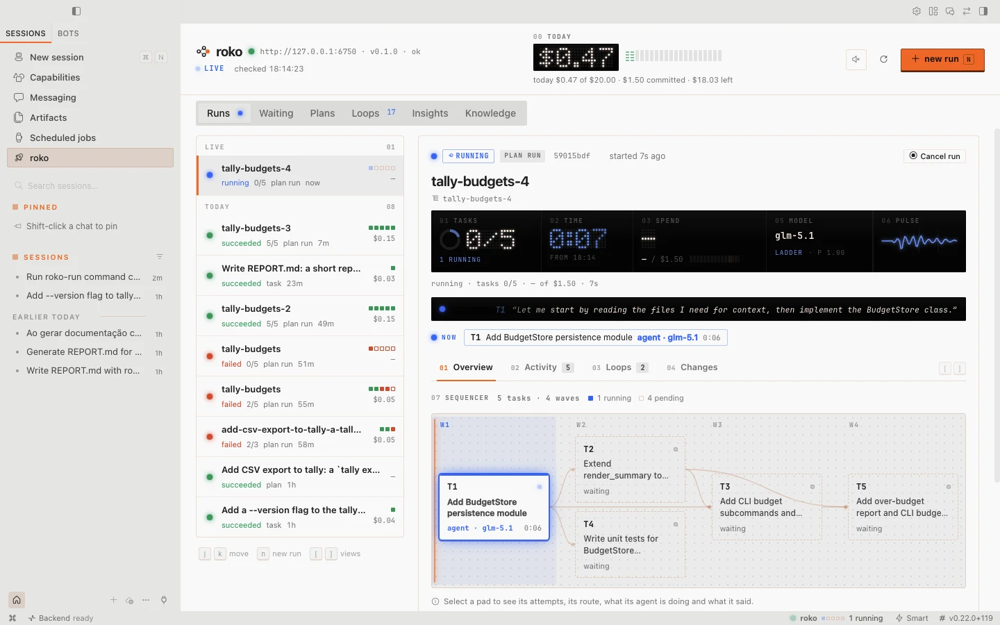

# Getting started

roko for Hermes lets you hand coding work from Hermes to [roko](https://github.com/wpank/roko). roko runs
the work as a checked task in your project: an agent makes the change on a separate branch, and your project's
checks (build, tests, lint) have to pass before roko calls it done. You review that branch and merge it.

This guide takes about five minutes, from nothing to your first verified change.

## What you need

- **Hermes Agent 0.21.6 or later**, already working: `hermes` starts a chat.
- **roko**, installed: `roko --version` prints a version. To build it, run `cargo install --path crates/roko-cli`
  in a clone of [roko's repository](https://github.com/wpank/roko) (Rust 1.91 or later; the first build takes a
  while).
- **A project in git** with at least one commit. Make sure its build output is ignored by git (`target/` for
  Rust, `node_modules/` for JavaScript, `__pycache__/` for Python): roko commits everything its agent leaves in the
  project.
- **A key for a model roko calls over an API**: OpenAI, Anthropic, OpenRouter, Cerebras, Z.ai or Moonshot. If Hermes
  already has one of these (an OpenRouter key, say), step 2 offers to give roko a copy. A run started from a chat
  holds anything that acts on the outside world for your approval, and only roko's own agent loop can do that, so
  these runs need such a model, not a CLI agent such as Claude Code.

## 1. Install the plugin

The plugin isn't published yet, so install it from your copy of the repository. Use the absolute path; the
folder must be a git repository, and Hermes installs its latest commit.

```bash
hermes plugins install file:///Users/you/code/hermes-plugin-roko --enable
```

```
Warning: custom (unreviewed) source — not from the Hermes catalog.
Warning: Using insecure/local URL scheme. Consider using https:// or git@ for production installs.
Cloning file:///Users/you/code/hermes-plugin-roko...
╭──────────────────────────────────────────╮
│ roko plugin installed. Next: …           │
╰──────────────────────────────────────────╯
✓ Plugin roko enabled.
Restart the gateway for the plugin to take effect:
  hermes gateway restart
```

Both warnings are expected for a local copy. The gateway is Hermes' link to Telegram, Discord and other chat apps:
restart it only if you run one.

## 2. Make your project ready: `hermes roko init`

```bash
cd ~/code/my-project
hermes roko init
```

It goes through everything a project needs, says what each step found, and asks before it changes anything. Here
it is in a small Python project, on a machine with no `~/.roko` yet, where Hermes has an OpenRouter key:

```
roko for Hermes: making /Users/you/code/my-project ready

✓ project: git checkout on main
✓ roko: roko 0.1.0 (…)
✓ roko home: created ~/.roko, where roko keeps its keys
  Copy OPENROUTER_API_KEY from Hermes to ~/.roko/.env, so roko can call OpenRouter? [y/N] y
✓ model key: copied OPENROUTER_API_KEY to ~/.roko/.env (only you can read it)
  Run `roko init` here to write roko.toml? [y/N] y
✓ roko.toml: `roko init` wrote it
  Start roko serve for this project in the background, on port 6677? [y/N] y
✓ roko serve: started at http://127.0.0.1:6677 (pid 81267), in the background
    stop it with: kill 81267   (or start it at login: hermes roko init --launchd)
· connect: connecting Hermes to roko serve:
  key: minted 'hermes' with the write scope
→ runs from Hermes: roko refuses runs started from Hermes in this workspace.
  -allow_without_data_llm = false
  +allow_without_data_llm = true
  Make this change? [y/N] y
→ models: roko has no model it can use for runs started from Hermes; roko.toml can name openai/gpt-5.4-mini (OpenRouter):
  Add openai/gpt-5.4-mini to roko.toml and put it on the model ladder's top rung? [y/N] y
✓ models: roko.toml names gpt-5-4-mini-openrouter (openai/gpt-5.4-mini), and roko can use it
→ learning: off. Turn on roko's learning (recommended):
  Turn on roko's learning (recommended)? [y/N] y
✓ learning: on, from roko's next run
✓ roko.toml in git: git does not track it, so it never blocks a merge
  Add the hello-world demo plan to plans/demos/demo-hello-world? [y/N] y
✓ demo: added plans/demos/demo-hello-world: one task writes a shell script that prints hello world
· desktop app: turn on roko's Desktop switch in Capabilities ▸ Plugins …

✓ Nothing stands between Hermes and roko.
```

What each step does:

| Step | What it checks, and what it offers to do |
|---|---|
| project | a git checkout with a commit (roko's runs work on branches of it) |
| roko | `roko` is installed (or `ROKO_BIN` names it) |
| roko home, model key | roko's key file `~/.roko/.env` has a key for an API model; if not, it copies the one Hermes has |
| roko.toml | runs `roko init` when the project has none |
| roko serve | uses the roko serve that runs for the project, or starts one in the background |
| connect | saves roko serve's address and the project in the plugin's settings, and creates a key for Hermes when roko serve has auth on |
| runs from Hermes | roko refuses work sent from a chat until `roko.toml` allows it; this changes the one line in `[serve.mcp]` (with roko's own `roko config preset chat-host` when your roko has it) |
| models | a run from Hermes needs a model roko calls over the API, with a price its cap can count; a recent `roko init` writes them from your keys, and for an older one this adds one to `roko.toml`. When none of roko's models has a price, it adds one roko has a price for on a new ladder rung above yours: runs with a cap use it, and terminal runs keep the rungs they start on. It never makes up rates for your models |
| learning | turns on the part of roko's learning that is safe today: the prompt section that carries lessons from verified work is never dropped (a control arm still holds lessons back from some tries), and the checks' thresholds update after every run. The self-model keeps to forecasts and dreams stay off ([Using roko](using-roko.md#turn-on-rokos-learning)) |
| roko.toml in git | when git tracks `roko.toml`, commits the change (only that file): the roko page merges a run's work only into a checkout without uncommitted changes |
| demo | adds a hello-world plan to try first |

Run it again any time: it changes only what is missing. `hermes roko init --dry-run` shows what it would do, and
`--yes` answers its questions for you. Without a terminal to ask on, it changes nothing and says to run `--yes`.

**roko serve** keeps running in the background after `hermes roko init` ends; stop it with the `kill` command it
printed. To have it start at every login instead, `hermes roko init --launchd` writes a macOS login item and prints
the `launchctl` command that loads it. To run it yourself in a terminal you leave open, use `--no-serve`, and
`roko serve` in the project.

**Optional: watch the agent's words live.** In the `[serve]` section of `roko.toml`, change the
`live_agent_output` line to `live_agent_output = "trusted"`, and restart roko serve. roko honours it only while
roko serve listens on this machine alone (the default), because these words reach the page before roko's output
screening.

## 3. Turn on the pages

- **Desktop app**: open Capabilities ▸ Plugins (Settings ▸ Plugins ▸ **Manage plugins** leads there) and turn on
  roko's **Desktop** switch. A **roko** entry appears in the sidebar and a **roko** chip in the status bar. If the
  app was already open when you installed the plugin, quit it with ⌘Q and open it again first: Hermes loads a
  plugin's backend only when it starts.
- **Web dashboard**: run `hermes dashboard`; it opens `http://127.0.0.1:9119`, where roko has its own tab.

If anything stands between Hermes and roko, the roko page opens with a **setup card** that names it and offers
the fix, in the same words as `hermes roko doctor`.

## 4. Run the demo

Open the roko page ▸ **Plans** ▸ **Start here: hello world demo** ▸ **Run plan**, with a $0.25 cap. Or ask in a
Hermes chat:

> Use roko to run the demo-hello-world plan. Cap it at $0.25.

One task writes `demo/hello-world/hello.sh`, a shell script that prints `hello world`, and its check runs the
script. It needs nothing installed beyond `sh`. In the run above it took 8 seconds and cost $0.003:

```
Passed: the demo-hello-world plan succeeded — its single task HELLO-1 passed its gate, delivering
demo/hello-world/hello.sh on branch roko/batch/f68b58a8-12a8-43d0-aa4c-79550ec28c46 (demo output, not merged).
Cost: $0.002623 of the $0.25 cap, in 8 seconds.
```

Look at the change, and leave it on its branch: merged demo output is clutter on your branch, and a later run of the
demo would find its check already passing and have nothing new to show.

## 5. Your first task

Start a new Hermes session (`hermes`) and ask for something small in your own project, with a cap:

> Use roko to add a `--verbose` flag to cli.py, with a unittest test. Cap it at $0.50.

> Use roko to add a `--json` option to the CLI in src/cli.js, with a test that `npm test` runs. Cap it at $0.50.

> Use roko to add a function is_even(n: i64) -> bool to src/lib.rs with a unit test. Cap it at $0.50.

Hermes asks before it spends anything:

```
╭───────────────────────────────────────────────────────────╮
│ ⚠️  Dangerous Command                                     │
│                                                           │
│ <roko_run> (plugin approval rule)                         │
│                                                           │
│ ❯ 1. Allow once                                           │
│   2. Allow for this session                               │
│   3. Add to permanent allowlist                           │
│   4. Deny                                                 │
│                                                           │
│ Spend up to $0.50 on one gated task in roko: “In          │
│ src/lib.rs add a public function `is_even(n: i64) ->      │
│ bool` …” (today: $0.00 spent of $20.00)                   │
╰───────────────────────────────────────────────────────────╯
  ↑/↓ to select, Enter to confirm
```

"Dangerous Command" is the title Hermes gives every approval. Press **Enter** to allow it once. If you don't
answer within 5 minutes, Hermes denies it and nothing runs. (With Hermes' approvals turned off, it doesn't ask.)

Hermes then follows the run and reports, about a minute later:

```
Done. roko run d0433458 — succeeded, 1/1 gate passed, 58s, cost $0.012 of the $0.50 cap.

What changed:
- src/lib.rs: added `pub fn is_even(n: i64) -> bool { n % 2 == 0 }` plus 4 unit tests.

Not merged. Review:
  git -C ~/code/my-project diff 824497bb2be6..roko/batch/d0433458-c719-4a28-b5d5-900a7501d462

Merge (fast-forward):
  git -C ~/code/my-project merge --ff-only roko/batch/d0433458-c719-4a28-b5d5-900a7501d462
```

A run ends **unverified** when no check ran: roko has no checks for your project yet. See "Your project's
checks" below.

## 6. Review and merge

roko never commits to the branch you have checked out. Each run's work is on its own branch,
`roko/batch/<run id>`. Use the two commands from the answer:

```bash
git -C ~/code/my-project diff 824497bb2be6..roko/batch/d0433458-…        # look at the change
git -C ~/code/my-project merge --ff-only roko/batch/d0433458-…           # take it
```

Lost the answer? `/roko status last` in Hermes shows the same commands. On the roko page, the run's **Changes**
tab shows the diff and merges it for you. Its display bar shows tasks, time, spend, checks and the model; the
header says **LIVE** while the page follows roko as it happens. Try **new run** next (⌘⌥R in the desktop app).



Two more things to try in the desktop app: the `roko` theme (Settings ▸ Appearance, or **use the roko theme** under
Settings ▸ Plugins ▸ roko), and the monitor pane ("roko: Monitor pane" in the command palette), which follows the newest
run beside your chat.

## Your project's checks

roko calls a task done only when your project's checks pass. A recent `roko init` writes them when it recognises
the project, and lists them (`gate rungs:`); an older one writes them only with `roko init --profile rust` or
`--profile typescript`. With none, every run ends unverified. To add one by hand, delete the line `rungs = []` under `[gates]` in `roko.toml`, and add at the end, with your project's
own test command:

```toml
[[gates.rungs]]
name = "test"
command = "python3 -m unittest discover -s tests -q"   # Node: "npm test"; Rust: "cargo test --workspace"
timeout_secs = 300
required = true
```

Edit the lines `roko init` wrote rather than pasting a section again: TOML refuses a section twice, and then roko
won't start. roko reads `roko.toml` again for every run, so the change needs no restart.

## By hand

`hermes roko init` does these steps; here they are one by one, for when you want to see each, or init stopped:

1. **A key for roko**: make roko's key file, which only you can read, and add the key to it with your editor (an
   `echo` would leave the key in your shell's history):
   ```bash
   mkdir -p ~/.roko && touch ~/.roko/.env && chmod 600 ~/.roko/.env
   ```
   Then add a line such as `OPENAI_API_KEY=sk-…` (or `ANTHROPIC_API_KEY`, `OPENROUTER_API_KEY`, …).
2. **roko.toml**: `roko init` in the project. A recent `roko init` writes a model ladder from the keys it finds,
   and prints it (`model ladder (cheapest first):`). An older one writes a ladder whose only model that runs is
   Claude on the `claude` CLI: add an API model by hand, here for an OpenAI key,
   ```toml
   [providers.openai]
   kind = "openai_compat"
   base_url = "https://api.openai.com/v1"
   api_key_env = "OPENAI_API_KEY"

   [models.gpt-5-4-mini]
   provider = "openai"
   slug = "gpt-5.4-mini"
   cost_input_per_m = 0.75
   cost_output_per_m = 4.5
   ```
   and in the `[[routing.ladder.rungs]]` entry with `name = "top"`, change the `model` line to
   `model = "gpt-5-4-mini"`. The prices let roko hold a run to its cap.
3. **roko serve**: `roko serve` in the project, in a terminal you leave open. It listens on
   `http://127.0.0.1:6677`. Restart it after you change `~/.roko/.env` (it reads keys only when it starts) or
   the `[serve]` section.
4. **Connect Hermes**: `hermes roko setup --workdir ~/code/my-project --mint`. It saves roko serve's address,
   creates a key for Hermes, checks every link, and offers the one-line change to `roko.toml` that lets runs from
   Hermes through (`hermes roko fix workspace-chat-ready` does only that).
5. **Commit roko.toml** when git tracks it: `git -C ~/code/my-project commit -m "roko: accept runs started from
   Hermes" -- roko.toml`.

`hermes roko doctor` checks every link at any time, and `hermes roko fix` lists what still needs fixing. If a line
starts with `✗`, the lines under it say what to do; see [Troubleshooting](troubleshooting.md).

## Next

- [Using roko from Hermes](using-roko.md): everyday tasks, with examples.
- [Reference](reference.md): every command and setting.
- [Troubleshooting](troubleshooting.md): what an error means and how to fix it.
- [Updating](updating.md): getting a new version of the plugin, and the restart that finishes it.
