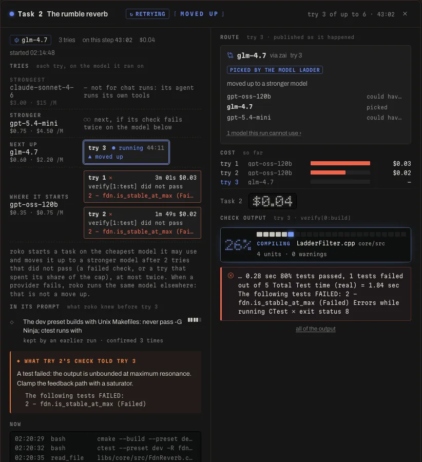
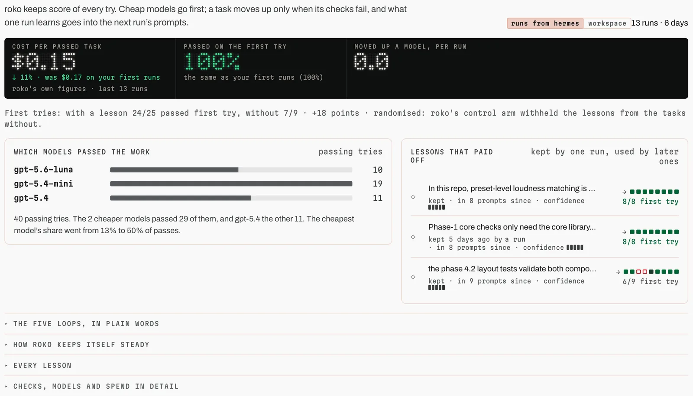
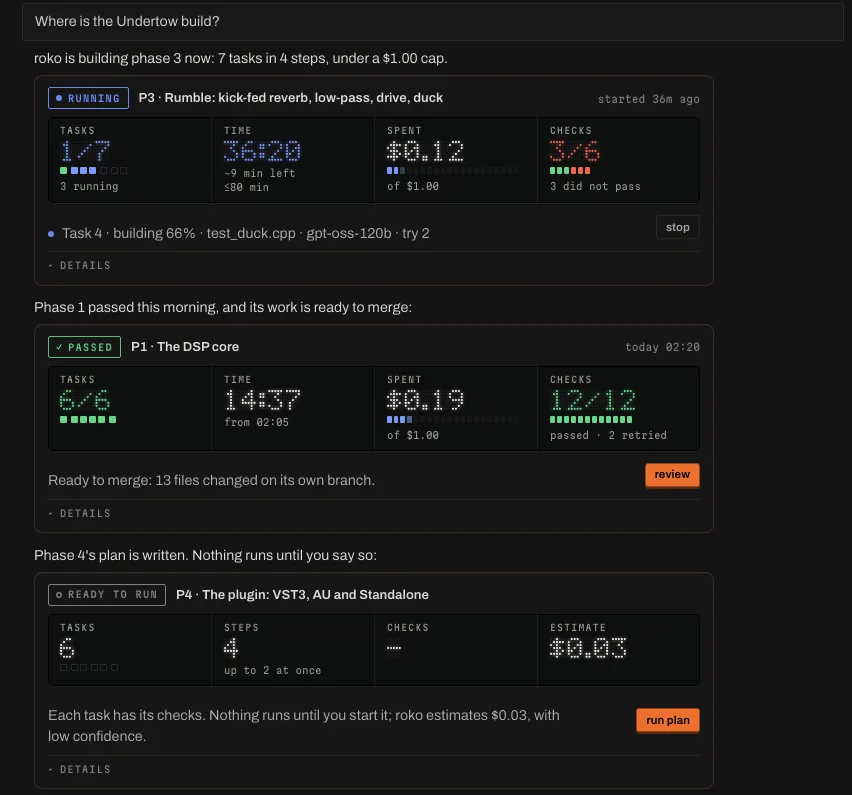

# Using roko from Hermes

There are two ways to work with roko from Hermes:

- **Ask Hermes** in plain words. It calls roko's tools, follows the run and reports back.
- **Type `/roko …`** to check or answer things yourself. These commands answer at once, without the model.

Both work in the terminal, the desktop app, and chat apps such as Telegram and Discord. The desktop app and the
web dashboard also have a roko page where you can start runs, watch them live, answer what waits on you, review and
merge the work, and see what roko learned ([below](#in-the-desktop-app-and-the-web-dashboard)).

## Ask for a change

> Use roko to add input validation to `parse_args` in src/cli.rs, with tests. Cap it at $1.

> Use roko to fix the failing test in tests/parser.rs. Max $0.50.

- Say **"use roko"**, so Hermes hands the work over instead of editing files itself.
- **Name a cap.** Every run needs one, and Hermes shows it when it asks you to approve the spend. A run may
  name at most $5 unless you raise `max_run_usd` ([Reference](reference.md#plugin-settings)).
- **Say what "done" means**: which tests must pass, and what must not change. roko's checks hold the agent to
  it.

Hermes asks before it starts (choose **Allow once**), follows the run, and reports the verdict, the cost and
where the change is. With Hermes' approvals off, it does not ask: see
[When Hermes approvals are off](#when-hermes-approvals-are-off).

The plugin tells the chat model to leave roko's work to roko. While a run goes and after it stops, the model is told
to report what roko says and offer the next step, and not to write the change itself, run the checks itself, or cancel
the run unless you ask, however quiet the run looks. When a run seems stuck, it is told to say what roko's status
shows (the model, its try, the spend so far and when it last did something) and ask what you want.

That is an instruction to the model, not a lock. In 5 live replays of one request in our tests (gpt-5.4-mini,
approvals off), the model kept to it every time, but a model can still write the change itself, for example after
roko stops a run at its cap. Hermes' approvals don't make it certain: they ask before roko's paid runs and before
dangerous commands, not before an ordinary file write. Only a chat with no tool that can change files cannot do
roko's work itself: without Hermes' `file`, `terminal`, `code_execution`, `delegation`, `computer_use` and `cronjob`
toolsets, and without an MCP server that writes files.

## Plan a bigger change first

> Use roko to plan adding CSV export to the reports page. Show me the plan; don't run it yet.

Planning costs a little, so Hermes asks first. The plan is a set of small tasks, each with its own check, in
steps: the tasks of one step can run side by side. `/roko plans PLAN` shows one:

```
plan add-two-new-functions-to-the-existing-src-lib-rs
1 task, up to 1 at once
estimate: $0.02, about 30s (medium confidence)
step 1:
  · Task 1 · Add pow and abs_diff functions with tests to src/lib.rs
      check: cargo test 2>&1 | grep 'test result' | grep -q '3 passed'
Run it from chat (the model asks you first), or: roko run plans/add-two-new-functions-to-the-existing-src-lib-rs
```

When it looks right:

> Run that plan with a cap of $2.

## Check on a run

Ask Hermes ("How's the roko run going?"), or look yourself:

```
/roko status last
✓ roko run dcb4a112 · succeeded · plan add-double-to-lib
succeeded · gates 1/1 · $0.01 of $0.40 · 46s · branch roko/work/add-double-to… (not merged)
tasks ▰ 1/1
spend ▰▱▱▱▱▱▱▱▱▱ $0.01 of $0.40 (3%)

Tasks:
  ✓ Task 1 · Add double function with doc comment and unit test to src/lib.rs · glm-5.1 · $0.01
      ✓ verify[0:test]

Result: branch roko/work/add-double-to-lib @ eb52d51370f0 (not merged yet)
  2 files changed, 18 insertions(+)
  Cargo.lock
  src/lib.rs
  review: git -C ~/code/my-project diff 3cfff55c8a68..roko/work/add-double-to-lib
  merge:  git -C ~/code/my-project merge --ff-only roko/work/add-double-to-lib
```

```
/roko runs
3 run(s) started from Hermes, newest first:
  ✓ e91356b6 succeeded · $0.006 of $0.30 · Add a doc comment to the sub function in src/lib.rs saying … · 2026-10-13 12:06
  ✓ bbbecddf succeeded · $0.007 of $0.30 · Write report.md: three short sentences on what the calc cra… · 2026-10-13 12:05
  ✗ a5cd0f70 failed · — of $0.50 · In src/lib.rs add a public function `is_odd(n: i64) -> bool… · 2026-10-13 12:04

today $0.01 of $20.00 ▰▱▱▱▱▱▱▱▱▱ <1%
Details: /roko status RUN_ID (or last)
```

A run's first 8 characters are enough: `/roko status e91356b6`.

To follow a run as it goes, open a second terminal:

```bash
hermes roko watch          # the newest run, live and full screen until it ends (q stops watching)
hermes roko watch e91356b6
```

### When a plan stopped part way

When a plan's last run stopped part way (a check failed, it hit its cap, or it was cancelled), roko keeps what
passed. Running the plan again then needs one word from you: continue, so only the tasks left run, or start
over, so every task runs again. Hermes asks you which before anything is approved or spent, and the roko page's
Run plan form shows both. Starting over sets the old run's progress aside; `roko resume RUN_ID` brings it back.

### When the run ends

A run outlives the chat turn that started it. When it ends, the chat that started it hears about it on your next
message: its first line says how the run ended (its tasks, its spend, and why when it failed), whatever you asked.
The chat hears each ending once. No other chat is told, and an ending the chat already saw in a status answer is
not repeated.

To have the chat speak up as soon as the run ends, without waiting for your next message, turn on
`run_end_follow_up` and let roko send that chat a turn:

```bash
hermes config set plugins.entries.roko.settings.run_end_follow_up true
hermes config set plugins.entries.roko.allow_gateway_injection true
```

Each ended run then costs one model call in that chat.

## When a run waits for you

Some work needs your sign-off before roko accepts it, or holds an action that reaches the outside world
(sending an email, posting, paying) until you approve it. Hermes tells you, and the desktop app sends a
notification.

```
/roko pending
[839944] the result of “Write report.md on the calc crate” (run bbbecddf)
    Is this summary what you asked for?
    report.md:
    The calc crate is a tiny calculator library that provides basic arithmetic operations. …
    answer by 2026-10-13T12:35:54+00:00 or the check is skipped

Answer with /roko approve CODE [NOTE] or /roko reject CODE [NOTE].
```

The deadline is roko's own: how long the sign-off waits before roko skips it and the task ends not checked.

```
/roko approve 839944
Recorded: approved the result of “Write report.md on the calc crate” (run bbbecddf).
```

To reject, add a note; it goes back to the run so the agent can try again:

```
/roko reject 839944 Make it two sentences, and mention the tests.
```

You can also tell Hermes "approve it"; it asks you to confirm before it answers for you.

## Find out why a run failed

```
/roko status last why
```

or ask "Why did the roko run fail?". Hermes quotes roko's reason, for example:

> The task never reached an agent. roko's model ladder routed it to the `claude-sonnet-4-6` model on the
> `claude_cli` provider, and that provider is unusable for this task: it "runs its own tools, so it cannot
> honour the task's `stage` policy". $0.00 spent.

[Troubleshooting](troubleshooting.md) lists the usual causes and their fixes.

## Stop a run

> Stop the roko run.

or `/roko cancel last`.

The plugin tells the chat model to cancel a run only when you ask, and to pass your reason along. A cancel from the
chat always shows on the run's card as "cancelled from chat: …" with that reason, so you can see that the chat
stopped it and why. Work that already passed its checks is kept.

## Keep an eye on money

```
/roko cost
roko spend from Hermes
today $0.01 of $20.00 ▰▱▱▱▱▱▱▱▱▱ <1%
left today: $19.99

Today's runs:
  ✓ e91356b6 succeeded · $0.006 of $0.30 · Add a doc comment to the sub function in src/lib.rs saying …
  ✓ bbbecddf succeeded · $0.007 of $0.30 · Write report.md: three short sentences on what the calc cra…

Each run is capped by its max_usd; the daily limit is plugins.entries.roko.settings.max_day_usd.
```

Runs started from Hermes may spend $20 a day in total. Hermes refuses a start that could pass that, counting
what running runs may still spend. To change the limit:

```bash
hermes config set plugins.entries.roko.settings.max_day_usd 10
```

## Ask what roko learned

roko keeps what its verified runs learned about your project:

> What does roko know about the calc crate?

```
/roko knowledge calc crate
• [StrategyFragment/Consolidated] The calc crate is a minimal single-function library (`sub`) operating on `i64` …
• [StrategyFragment/Consolidated] The `calc` crate follows a simple pattern: public `i64` functions with doc …
```

### Turn on roko's learning

roko learns from the work that passes its checks, and `hermes roko init` offers to turn on the part of that learning
that is safe today (`hermes roko doctor` and the roko page say `learning: on` or `off`). It changes two settings in
the workspace's `roko.toml`: the prompt section that carries the lessons roko keeps from verified work is never
dropped from a later task's prompt (`[sections] pinned = ["domain_context"]`; a prompt still carries only the few
lessons that match best, and the control groups below hold lessons back from some tries), and the checks' learned
thresholds are saved after every verify run instead of every tenth (`[learning] gate_threshold_flush_interval = 1`). It keeps the self-model to
forecasts (`[self_model] mode = "shadow"`), the guard on what a run taught to logging
(`[learning] guarded_commit = "observe"`), and the control groups that measure what each loop is worth
(`[experiments] maximize = false`). What it does not change: a task still starts on the model its kind of work
starts on, so roko gets cheaper through its lessons, fewer tries and fewer moves to a stronger model, not yet by
starting on a cheaper model; and roko's offline consolidation ("dreams") and its affect engine stay off, because a
dream today can push a real lesson out of a prompt. Turning it on is yours: the plugin tells Hermes to point you to
`hermes roko init` and to leave `roko.toml` alone.

## Point Hermes at a run

`@roko:last` (or `@roko:<run id>`) puts a run's card into your message:

> Explain @roko:last to me in two sentences.

## Review and merge the work

roko never commits to the branch you have checked out. Each run's verified work is on its own branch,
`roko/work/<name>`, named after its plan or your request (older runs are on `roko/batch/<run id>`). In the desktop
app or the dashboard, a passed run's **review** key opens its changes, and its merge key takes them
([below](#review-and-merge-from-the-page)). In a terminal, the run's card gives the commands:

```bash
git -C ~/code/my-project diff <base>..roko/work/<name>        # see what changed
git -C ~/code/my-project merge --ff-only roko/work/<name>     # take it
```

Once you have merged, the card says `merged`. Not happy with the change? Don't merge it; ask for a new run
instead.

## When roko says no

When roko refuses a run or a run fails, the plugin tells Hermes to say what roko said and what you can do, and to
stop. It is told not to repair roko for you: to leave roko's worktrees, branches, `.roko/` folder and `roko.toml`
alone, not to start or restart `roko serve`, and not to run the work again, or do it itself, unless you ask. Those
are your calls, and some of them spend money. As above, these are instructions, not locks.

- **roko refuses runs from Hermes** in this workspace: the setup card on the roko page has a **make ready** key, and
  `hermes roko fix workspace-chat-ready` does the same in a terminal. Both show the change to `roko.toml` before
  they make it, and roko picks it up at once.
- **A run failed**: ask why (`/roko status last why`), then ask for a new run, or resume a plan, if you want one.
- **roko itself is stuck** (roko serve is down, or a crash left something behind): Hermes is told to say what roko
  reported.
  [Troubleshooting](troubleshooting.md) lists the usual causes and their fixes.
- **A checkout left behind** blocks a task: Hermes is told to run no git command of its own on roko's worktrees or
  branches, even if you ask. When roko's message gives a command that moves the checkout aside (it keeps the
  commits), it is told to run exactly that command if you ask it to in that turn, and otherwise to tell you what roko
  said.

### roko has no priced model for runs from Hermes

roko holds a run from Hermes to its cap, and it can count only the calls of a model it has a price for. So it refuses
every such run while none of the models the run can use has a price, and says which models those are (`roko doctor`
in the workspace lists them too). roko's own price table covers the common models; for another one, give it its real
rates on its `[models.<name>]` entry in the workspace's `roko.toml`, in dollars per million tokens:

```toml
cost_input_per_m = 0.15
cost_output_per_m = 0.60
```

Use what its provider charges: 0 is only for a free local model, because the cap counts spend by these rates. roko
serve reads the change within seconds, with no restart. Or give roko another model that has a price:
`hermes roko init` offers one when `~/.roko/.env` has a key it knows, and
[roko has no model for runs started from Hermes](troubleshooting.md#roko-has-no-model-for-runs-started-from-hermes)
shows how by hand. The plugin tells Hermes to report the refusal and leave `roko.toml` to you.

## When Hermes approvals are off

Hermes' `approvals.mode` is `smart` unless you change it. With `smart` or `manual`, Hermes asks you before each paid
roko tool starts work: Hermes' smart check judges only shell commands, never a plugin's request. With `off`, Hermes
approves every tool call by itself:

- a chat starts roko runs, plans and plan runs without a question, up to the plugin's caps (`max_run_usd` for a run,
  `max_day_usd` for the day);
- `roko_decide` records an answer without the confirmation;
- the chat's terminal commands run without a question too, in any folder, roko's workspace included.

The setup card on the roko page and `hermes roko doctor` warn about it (`approvals-off`). To be asked again, click
**⚡ Off** at the bottom right of the desktop app and choose **Smart** (or **Manual**), or run:

```bash
hermes config set approvals.mode smart
```

Hermes picks the change up at once.

Hermes cannot ask about only some tools while approvals are off: `off` skips every approval, the ones a plugin asks for
included. If you keep it off, these Hermes settings still hold:

```yaml
approvals:
  mode: "off"
  deny:                      # terminal commands Hermes never runs, even with approvals off
    - "*worktree remove*"
    - "*rm *.roko*"
security:
  protected_instruction_extra_patterns:
    - "roko.toml"            # Hermes' file tools ask you, every time, before they write a roko.toml
skills:
  write_approval: true       # skills Hermes writes wait for you: /skills pending, /skills approve <id>
```

`deny` stops Hermes from running those commands; you can still run them in your own terminal. A shell command can
still change `roko.toml`: only Hermes' own file tools ask.

When a paid roko tool starts without asking you, its answer says so and tells Hermes to tell you that the run started
and what it may spend.

### What Hermes learns from a roko turn

After a turn with many tool calls, Hermes reviews the conversation in the background and may save what it learned as
a skill or a memory, without asking you. After a roko refusal or failure, that review can save the wrong lesson: a skill
telling later chats to remove roko's worktrees, edit `roko.toml` or run paid work again on their own.

To be asked before Hermes keeps a skill it wrote itself, turn on its write approval:

```bash
hermes config set skills.write_approval true
```

Skills Hermes writes then wait for you: `/skills pending` lists them, `/skills diff <id>` shows one, and
`/skills approve <id>` or `/skills reject <id>` decides. `memory.write_approval: true` does the same for memories.
This works with approvals off, and it is the way to stop the background review from saving recipes unasked.

The plugin also has an opt-in **learning guard** (Hermes 0.22 and later). With it on, it refuses such a write from the
background review: a skill or memory that teaches git surgery on roko's worktrees or branches, deleting `.roko`,
editing `roko.toml`, killing roko serve, or running paid roko work again or without your permission. A sentence that
forbids these is fine, and other skills and memories, notes about roko included, are not affected. To turn it on, then
restart Hermes:

```bash
hermes config set plugins.entries.roko.settings.learning_guard true
```

It is off by default because of a Hermes limit. Hermes checks a plugin's tool-call hook per hook, callback and call
id, and tool calls that carry no call id (the ones `execute_code` makes, Hermes' tools served to CLI agents over MCP,
connectors) share one key. While any such hook is registered, two of those calls at the same moment can have the
second one refused ("pre_tool_call plugin callback timed out or is still running"). With the guard off, the plugin
registers no tool-call hook. Its three turn hooks, which add a run's card line to a desktop reply that leaves it
out (docs/ui-api.md, "Chat cards"), are not tool-call hooks.

## In the desktop app and the web dashboard

roko's page has three tabs, **Runs**, **Plans** and **Learning**, in the desktop app and in the web dashboard alike.
It follows roko live: what roko does reaches the page within milliseconds, and the light after roko's wordmark is lit
while it does (hover it to read why when it is not).


Four colours mean the same thing everywhere: **blue**, roko is working; **green**, a check passed; **red**, a check did
not pass; **orange**, something waits on you, or the one key to press next. Everything else is ink and grey. Numbers
that change (tasks, time, spend, checks) sit on black glass in roko's dot-matrix face.

### Start a run

Press **new run** (or `n` on the page, ⌘⌥R anywhere in the desktop app, "roko: New run…" in the command palette, or
the `→ roko` key in a chat's composer, which brings the chat's draft along):


- **The request**, stated completely: roko's agent sees only this text. Under an empty box, **try** offers example
  requests, and the demo roko has for this project.
- **Write a plan first** (the desktop app's switch; **run it | plan first** in the dashboard): one checked task now, or
  a plan written first by roko's planner, which you read and then run.
- **The cap**: keys for $0.25, $0.50, $1, $2 and $5, up to your per-run limit and what is left of today's budget.
- **The sentence** under them says what will happen: what roko expects to spend once it can estimate the work, or
  what writing a plan costs.
- **more** holds the rest: where the run starts on roko's models, the kind of work (code, research or docs), an exact
  cap, a name for your run lists, and a plan roko already has.

⌘↵ (Ctrl+Enter) starts it. If another run holds roko's workspace, the new one waits in a queue and says its place.

An empty chat that already has a session also offers **delegate to roko**, with example requests that fill the
composer. A new chat shows Hermes' own start screen instead; there, the **→ roko** key beside the model picker is the
way in.

### Watch it

A run is a page. Its head has:

- the run's state (**running**, **passed**, **failed**, **stopped**, **needs you**) and its title, what you asked for;
- four readings on the glass: **tasks** passed, with the plan drawn as a strip of squares; **time**, with roko's
  estimate of what is left; **spent**, against the cap, with a meter; and **checks** passed;
- one sentence: what is happening now ("Task 2 · run_tests · gpt-5.4-mini"), where the work is, or why it ended;
- one key: **stop** while it runs, **review** once it passed, **run again** after a failure.

Below the head, **the plan** runs step by step: a pad per task, its light and border saying where the task is
(working, passed, waiting on you, did not pass, never ran), its squares its checks, and its time. Beside it,
**the models** the run used, cheapest first: a task moves up to a stronger model only after its checks failed twice.
Then what the run made, and what roko learned from it. Folded at the end: what the agents are doing (the newest tool
steps and words, and the full stream), every step, where the time went, the changes, the receipt, and **about this
run** (its id, where it came from, the tokens it used).

On a phone, the dashboard's page stacks the same parts:

<p></p>

To see the agent's words as it writes them, roko needs `[serve] live_agent_output = "trusted"` in `roko.toml` (it
takes effect only when roko serve listens on loopback). roko streams words for plan runs (**plan first**); a single
task's words (**run it**) arrive when its try ends.

### Look inside a task

Click a pad:



You see each try on the model it ran on, and why the task moved up; who picked the model (roko's model ladder, what
it learned, the task's own hint) and the other models it weighed; what each try cost; what its prompt carried (the
lessons roko gave it, and what the previous try's check told it); what its agent is doing now; and what its check
printed, with the line that says why. `↑`/`↓` step through its tries, `c` copies the key line, `o` shows all of the
output.

### Find out why

A run that did not pass says why under its head, in one paragraph: which check did not pass and the line of its
output that says why, which tasks that blocked, or what a stopped run had finished. **Inspect** opens the task.

### Replay a run

On a finished run, press **Replay** in its plan: the plan goes back to the start and plays the run again (▶ plays
it, or drag along it). It shows where the time went and what ran at the same time.

### Review and merge from the page

A run that passed has one orange key, **review**.


It opens the run's changes: the files on the left, each file's changes on the right. **merge into main** takes exactly
the commit you reviewed into the branch your checkout is on, after a dialog: a fast-forward when nothing else changed,
or a merge commit when your branch moved on without conflicting. Then it shows the command that undoes it.


When it can't merge (uncommitted changes, a conflict, a checkout in the middle of a rebase, roko on another
machine), it says why and gives the command to run yourself. A merged run says where its work went, and has no key.

### Answer what a run waits on

What waits on you comes first on **Runs**, under **needs you**: a sign-off on a task's result, or an action roko held
(a message to send, a post, a payment). A sign-off shows the work and roko's own deadline counting down, with two
keys, **decline** and **approve**. A decline fails the check with your note, and the task's next try gets the note.
If nobody answers before the deadline, roko skips the check and the task ends not checked.

### Plans

Every plan roko has, a line each, and each plan its own page: its document, its tasks with their checks, roko's
estimate, and **run plan** with a cap. A project built in phases (its specs named `docs/specs/phase-<n>-<name>.md`)
gets its build at the top: the phases on the glass, what to do next in one sentence with its key, and a pad per phase.


### Learning

Three readings say whether roko is getting better at your project: what a passed task costs, how often a task passes
on its first try, and how often a task moves up to a stronger model, each against your first runs. Below them, which
models passed the work and the lessons that paid off. Folded: roko's five loops in plain words, how it keeps itself
steady, every lesson it keeps (with a search), and the checks' figures. **runs from hermes** counts the runs Hermes
started in this project; **workspace** counts every run roko recorded here.



### Beside the chat

In a chat, a run is a card with the same head as its page, and it moves while the run does: a running run with
**stop**, a passed one with **review**, a written plan with **run plan**.



In the desktop app, the **side pane** in the right sidebar (palette: "roko: Monitor pane") follows the newest run
while you chat. The sidebar row of a chat whose run is going shows a light (blue: working; orange: waits on you),
and Hermes' pet says when a run ends or needs you.


In the web dashboard, a chip in the header says roko's most urgent state, and one line above the chat and on
Sessions follows a run while it goes or something waits on you.


### Settings, theme and sounds

**Settings ▸ Plugins ▸ roko** in the desktop app (the gear on the dashboard's page) shows the connection and whether
the live stream is open, your limits, the sound switch, the `roko` theme and the doctor's checks.

The `roko` theme (aluminium by day, graphite by night, orange for what needs you) is a Hermes theme: pick it in
Settings ▸ Appearance or with **use the roko theme** on roko's settings. Sounds are off until you turn them on: short
blips when a check or a task passes, a run ends, or something needs you; never while the window is hidden.

### Keys

| Key | Where | Does |
|---|---|---|
| ⌘⌥R | anywhere in the desktop app | New run |
| `n` | the roko page | New run |
| `1` `2` `3` | the roko page | Runs, Plans, Learning |
| `w` | the desktop page | what waits on you, at the top of Runs |
| `[` / `]` | a run, on the desktop | the previous / next part of the run |
| `j` / `k` | a run | the next / previous run |
| `↑` / `↓` | a task's panel | its tries |
| `r` | the roko page | check again now |
| `Esc` | a task's panel or a dialog | close it |
| `?` | the dashboard's roko tab | all keys |

Clicks on these pages count as your own decisions, so they don't ask twice; a paid start still shows its cap first.
Set `ui_actions` to `false` to make both pages read-only.
