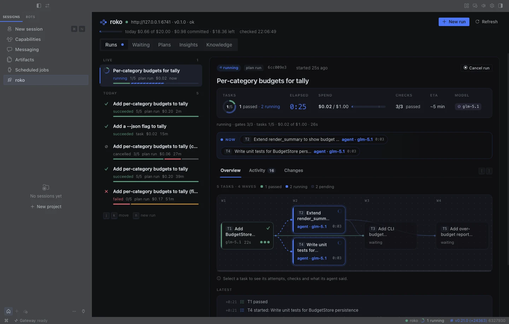
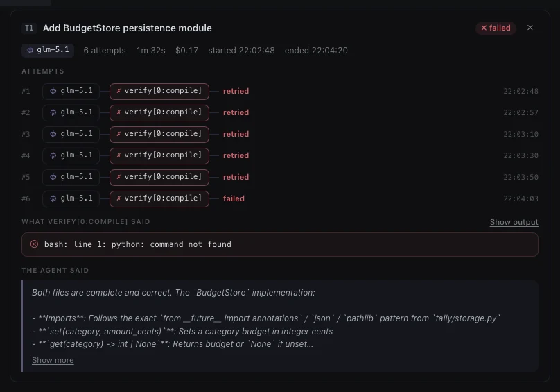
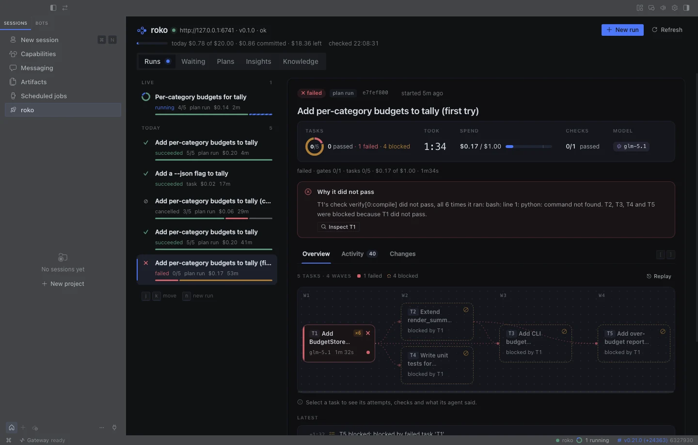
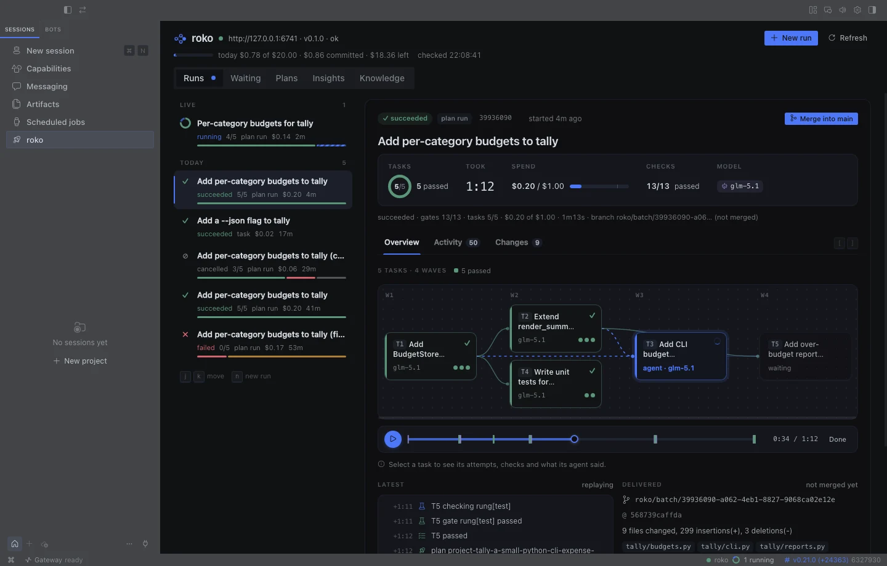
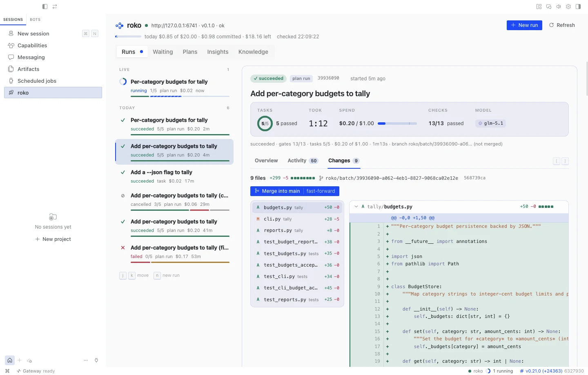
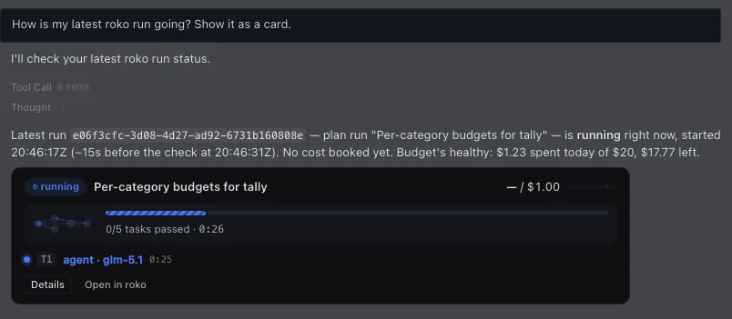

# Using roko from Hermes

There are two ways to work with roko from Hermes:

- **Ask Hermes** in plain words. It calls roko's tools, follows the run and reports back.
- **Type `/roko …`** to check or answer things yourself. These commands answer at once, without the model.

Both work in the terminal, the desktop app, and chat apps such as Telegram and Discord. The desktop app and the
web dashboard also have a roko page where you can start runs, watch them, and review and merge their work
([below](#in-the-desktop-app-and-the-web-dashboard)).

## Ask for a change

> Use roko to add input validation to `parse_args` in src/cli.rs, with tests. Cap it at $1.

> Use roko to fix the failing test in tests/parser.rs. Max $0.50.

- Say **"use roko"**, so Hermes hands the work over instead of editing files itself.
- **Name a cap.** Every run needs one, and Hermes shows it when it asks you to approve the spend. A run may
  name at most $5 unless you raise `max_run_usd` ([Reference](reference.md#plugin-settings)).
- **Say what "done" means**: which tests must pass, and what must not change. roko's checks hold the agent to
  it.

Hermes asks before it starts (choose **Allow once**), follows the run, and reports the verdict, the cost and
where the change is.

## Plan a bigger change first

> Use roko to plan adding CSV export to the reports page. Show me the plan; don't run it yet.

Planning costs a little, so Hermes asks first. The plan is a set of small tasks, each with its own check, in
waves that can run side by side. `/roko plans PLAN` shows one:

```
plan add-two-new-functions-to-the-existing-src-lib-rs
1 task(s), up to 1 at once
estimate: $0.02, about 30s (medium confidence)
wave 1:
  · T1 Add pow and abs_diff functions with tests to src/lib.rs
      check: cargo test 2>&1 | grep 'test result' | grep -q '3 passed'
```

When it looks right:

> Run that plan with a cap of $2.

## Check on a run

Ask Hermes ("How's the roko run going?"), or look yourself:

```
/roko status last
✓ roko run dcb4a112 · succeeded · plan add-double-to-lib
succeeded · gates 1/1 · $0.01 of $0.40 · 46s · branch roko/batch/dcb4a112-176… (not merged)

Tasks:
  ✓ T1 Add double function with doc comment and unit test to src/lib.rs · glm-5.1 · $0.01
      ✓ verify[0:test]

Result: branch roko/batch/dcb4a112-1768-4b1d-831e-008f5291ba2e @ eb52d51370f0 (not merged yet)
  2 files changed, 18 insertions(+)
  Cargo.lock
  src/lib.rs
  review: git -C ~/code/my-project diff 3cfff55c8a68..roko/batch/dcb4a112-…
  merge:  git -C ~/code/my-project merge --ff-only roko/batch/dcb4a112-…
```

```
/roko runs
3 run(s) started from Hermes, newest first:
  ✓ e91356b6 succeeded · $0.006 of $0.30 · Add a doc comment to the sub function in src/lib.rs saying … · 2026-10-13 12:06
  ✓ bbbecddf succeeded · $0.007 of $0.30 · Write report.md: three short sentences on what the calc cra… · 2026-10-13 12:05
  ✗ a5cd0f70 failed · — of $0.50 · In src/lib.rs add a public function `is_odd(n: i64) -> bool`… · 2026-10-13 12:04

today $0.01 of $20.00
Details: /roko status RUN_ID (or last)
```

A run's first 8 characters are enough: `/roko status e91356b6`.

To follow a run as it goes, open a second terminal:

```bash
hermes roko watch          # the newest run, live and full screen until it ends (q stops watching)
hermes roko watch e91356b6
```

## When a run waits for you

Some work needs your sign-off before roko accepts it, or holds an action that reaches the outside world
(sending an email, posting, paying) until you approve it. Hermes tells you, and the desktop app sends a
notification.

```
/roko pending
[839944] the result of “Write report.md on the calc crate” (run bbbecddf)
    Is this summary what you asked for?
    report.md:
    The calc crate is a tiny calculator library that provides basic arithmetic operations. …
    answer by 2026-10-13T12:35:54+00:00 or the check is skipped

Answer with /roko approve CODE [NOTE] or /roko reject CODE [NOTE].
```

The deadline is roko's own: how long the sign-off waits before roko skips it and the task ends unverified.

```
/roko approve 839944
Recorded: approved the result of “Write report.md on the calc crate” (run bbbecddf).
```

To reject, add a note; it goes back to the run so the agent can try again:

```
/roko reject 839944 Make it two sentences, and mention the tests.
```

You can also tell Hermes "approve it"; it asks you to confirm before it answers for you.

## Find out why a run failed

```
/roko status last why
```

or ask "Why did the roko run fail?". Hermes quotes roko's reason, for example:

> The task never reached an agent. roko's model ladder routed it to the `claude-sonnet-4-6` model on the
> `claude_cli` provider, and that provider is unusable for this task: it "runs its own tools, so it cannot
> honour the task's `stage` policy". $0.00 spent.

[Troubleshooting](troubleshooting.md) lists the usual causes and their fixes.

## Stop a run

> Stop the roko run.

or `/roko cancel last`.

## Keep an eye on money

```
/roko cost
roko spend from Hermes
today $0.01 of $20.00
left today: $19.99

Today's runs:
  ✓ e91356b6 succeeded · $0.006 of $0.30 · Add a doc comment to the sub function in src/lib.rs saying …
  ✓ bbbecddf succeeded · $0.007 of $0.30 · Write report.md: three short sentences on what the calc cra…
```

Runs started from Hermes may spend $20 a day in total. Hermes refuses a start that could pass that, counting
what running runs may still spend. To change the limit:

```bash
hermes config set plugins.entries.roko.settings.max_day_usd 10
```

## Ask what roko learned

roko keeps what its verified runs learned about your project:

> What does roko know about the calc crate?

```
/roko knowledge calc crate
• [StrategyFragment/Consolidated] The calc crate is a minimal single-function library (`sub`) operating on `i64` …
• [StrategyFragment/Consolidated] The `calc` crate follows a simple pattern: public `i64` functions with doc …
```

## Point Hermes at a run

`@roko:last` (or `@roko:<run id>`) puts a run's card into your message:

> Explain @roko:last to me in two sentences.

## Review and merge the work

roko never commits to the branch you have checked out. Each run's verified work is on its own branch,
`roko/batch/<run id>`. In the desktop app or the dashboard, open the run's **Changes** tab and click **Merge**
([below](#review-and-merge-from-the-page)). In a terminal, the run's card gives the commands:

```bash
git -C ~/code/my-project diff <base>..roko/batch/<run id>        # see what changed
git -C ~/code/my-project merge --ff-only roko/batch/<run id>     # take it
```

Once you have merged, the card says `merged`. Not happy with the change? Don't merge it; ask for a new run
instead.

## In the desktop app and the web dashboard

The roko page is mission control for your runs. The desktop app and the web dashboard show the same things, each in
its own look.



### Start a run

Click **New run** (or press `n` on the page, or ⌘⌥R anywhere in the desktop app, or pick "roko: New run…" in the
command palette):


- **What should roko do?** The request, stated completely: roko's agent sees only this text.
- **Run it** runs the request as one checked task. **Plan it first** has roko's planner write a plan; the page shows it
  being written, then the plan with **Run plan…**.
- **Name it** (optional) is what your run lists show.
- **Spend cap**: pick one; caps above your per-run limit or today's remaining budget can't be picked.
- **Kind of work**: code (checked by your build, tests and lint), research or docs.

⌘↵ (Ctrl+Enter) starts it. If another run holds roko's workspace, the new one waits in a queue and says its position.

### Watch it

The run's page has three parts:

- **Instruments**: how many tasks passed (the ring), the time so far, spend against the cap (with where this pace ends
  up), checks passed, roko's estimate of the time left, and the models doing the work.
- **Now**: what each running task is doing this second: its agent at work, or which check runs.
- **The graph**: one column per wave of tasks that can run together. A task's border says where it is (waiting,
  running, passed, failed, blocked); its dots are its checks; ×3 means its third attempt.

**Activity** (`]` switches tabs) is the run's log in words, with filters for agents, checks and problems. Agent lines
quote what the agent said.

### Look inside a task

Click a task in the graph:



You see every attempt with its model and its checks, the check output with the line that matters marked, and the
agent's last message.

### Find out why

A run that did not pass says why above its graph, in one paragraph: which check did not pass and the line of its
output that says why, which tasks that blocked, or what a cancelled run had finished.



### Replay a run

On a finished run, click **Replay**: the graph goes back to the start and replays the run (▶ plays it, or drag the
scrubber). It is a quick way to see where the time went, or what ran in parallel.



### Review and merge from the page

A finished run's **Changes** tab shows its diff: the files on the left, each file's changes on the right.



**Merge into main** takes exactly the commit you reviewed into the branch your checkout is on: a fast-forward when
nothing else changed, or a merge commit when your branch moved on without conflicting. It shows the command that
undoes it. When it can't merge (uncommitted changes, a conflict, a checkout in the middle of a rebase, roko on another
machine), it says why and gives the command to run yourself.

### Answer what a run waits on

**Waiting** lists every sign-off and held action, with what the work produced, roko's deadline, and Approve or Reject
(with an optional note that goes back to the run).

### The other tabs

| Tab | What you can do |
|---|---|
| **Plans** | See a plan as a graph, its tasks and checks and roko's estimate, and run it with a cap |
| **Insights** | Check pass rates, which models roko used and what they cost, spend over time, and the connection checks |
| **Knowledge** | Search what roko learned |

### In the chat

Ask Hermes about a run in the desktop app and it can answer with a live card: the run's graph in small, its progress,
what it is doing now, and, once it ends, the changes with **Review & merge**.



### Keys

| Key | Where | Does |
|---|---|---|
| ⌘⌥R | anywhere in the desktop app | New run |
| `n` | the roko page | New run |
| `j` / `k` (or ↓ / ↑) | the run list | next / previous run |
| `[` / `]` | a run | previous / next tab (Overview, Activity, Changes) |
| `Esc` | a task panel or dialog | close it |
| `?` | the dashboard's roko tab | all keys |

A chip in the status bar (desktop) or the header (dashboard) shows a small progress ring for the newest active run and
how many runs wait on you. Clicks on these pages count as your own decisions, so they don't ask twice; a paid start
still shows its cap first. Set `ui_actions` to `false` to make both pages read-only.
