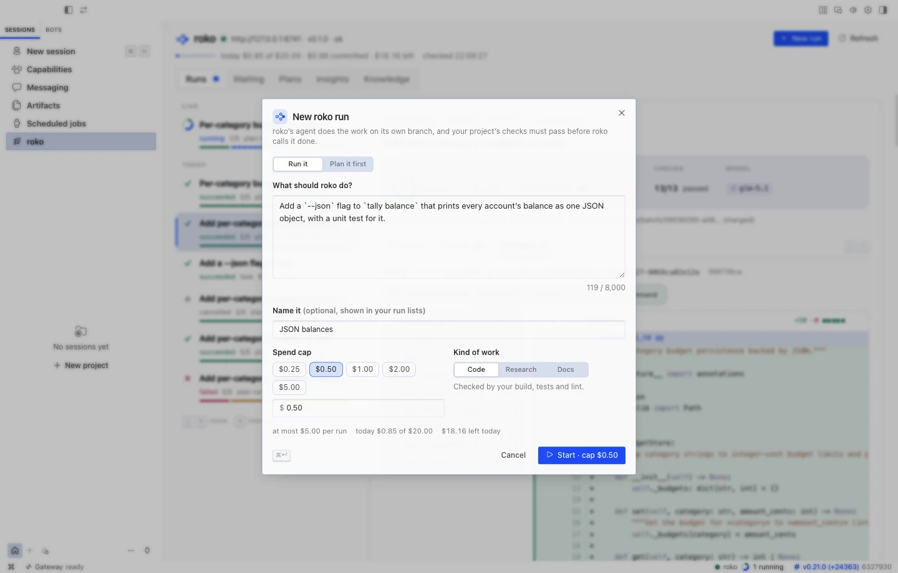
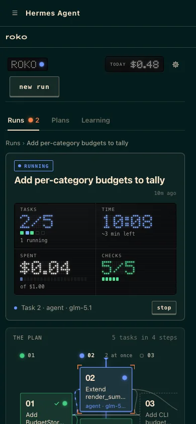
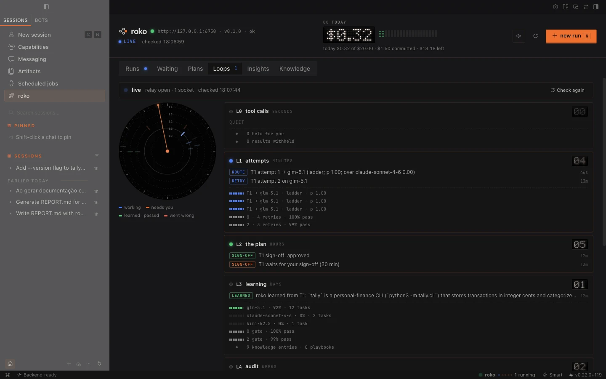
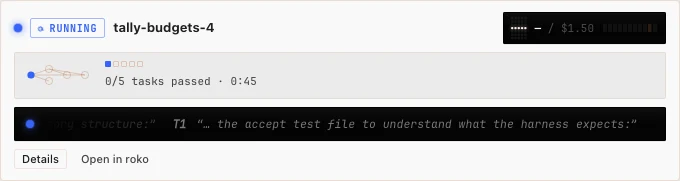
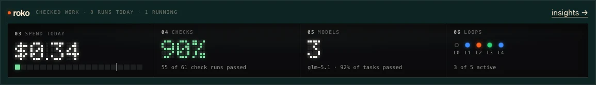
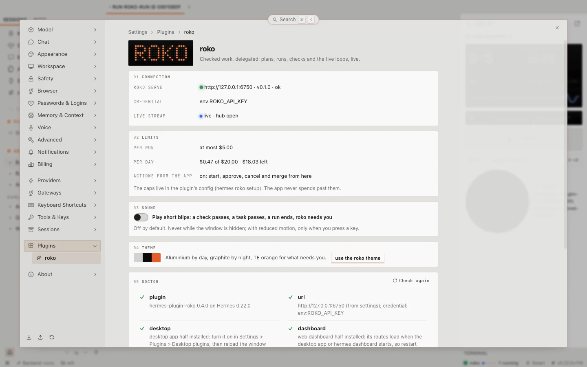

# Using roko from Hermes

There are two ways to work with roko from Hermes:

- **Ask Hermes** in plain words. It calls roko's tools, follows the run and reports back.
- **Type `/roko …`** to check or answer things yourself. These commands answer at once, without the model.

Both work in the terminal, the desktop app, and chat apps such as Telegram and Discord. The desktop app and the
web dashboard also have a roko page where you can start runs, watch them live, see roko's loops at work, answer what
waits on you, and review and merge the work ([below](#in-the-desktop-app-and-the-web-dashboard)).

## Ask for a change

> Use roko to add input validation to `parse_args` in src/cli.rs, with tests. Cap it at $1.

> Use roko to fix the failing test in tests/parser.rs. Max $0.50.

- Say **"use roko"**, so Hermes hands the work over instead of editing files itself.
- **Name a cap.** Every run needs one, and Hermes shows it when it asks you to approve the spend. A run may
  name at most $5 unless you raise `max_run_usd` ([Reference](reference.md#plugin-settings)).
- **Say what "done" means**: which tests must pass, and what must not change. roko's checks hold the agent to
  it.

Hermes asks before it starts (choose **Allow once**), follows the run, and reports the verdict, the cost and
where the change is. With Hermes' approvals off, it does not ask: see
[When Hermes approvals are off](#when-hermes-approvals-are-off).

## Plan a bigger change first

> Use roko to plan adding CSV export to the reports page. Show me the plan; don't run it yet.

Planning costs a little, so Hermes asks first. The plan is a set of small tasks, each with its own check, in
waves that can run side by side. `/roko plans PLAN` shows one:

```
plan add-two-new-functions-to-the-existing-src-lib-rs
1 task(s), up to 1 at once
estimate: $0.02, about 30s (medium confidence)
wave 1:
  · T1 Add pow and abs_diff functions with tests to src/lib.rs
      check: cargo test 2>&1 | grep 'test result' | grep -q '3 passed'
```

When it looks right:

> Run that plan with a cap of $2.

## Check on a run

Ask Hermes ("How's the roko run going?"), or look yourself:

```
/roko status last
✓ roko run dcb4a112 · succeeded · plan add-double-to-lib
succeeded · gates 1/1 · $0.01 of $0.40 · 46s · branch roko/batch/dcb4a112-176… (not merged)

Tasks:
  ✓ T1 Add double function with doc comment and unit test to src/lib.rs · glm-5.1 · $0.01
      ✓ verify[0:test]

Result: branch roko/batch/dcb4a112-1768-4b1d-831e-008f5291ba2e @ eb52d51370f0 (not merged yet)
  2 files changed, 18 insertions(+)
  Cargo.lock
  src/lib.rs
  review: git -C ~/code/my-project diff 3cfff55c8a68..roko/batch/dcb4a112-…
  merge:  git -C ~/code/my-project merge --ff-only roko/batch/dcb4a112-…
```

```
/roko runs
3 run(s) started from Hermes, newest first:
  ✓ e91356b6 succeeded · $0.006 of $0.30 · Add a doc comment to the sub function in src/lib.rs saying … · 2026-10-13 12:06
  ✓ bbbecddf succeeded · $0.007 of $0.30 · Write report.md: three short sentences on what the calc cra… · 2026-10-13 12:05
  ✗ a5cd0f70 failed · — of $0.50 · In src/lib.rs add a public function `is_odd(n: i64) -> bool`… · 2026-10-13 12:04

today $0.01 of $20.00
Details: /roko status RUN_ID (or last)
```

A run's first 8 characters are enough: `/roko status e91356b6`.

To follow a run as it goes, open a second terminal:

```bash
hermes roko watch          # the newest run, live and full screen until it ends (q stops watching)
hermes roko watch e91356b6
```

## When a run waits for you

Some work needs your sign-off before roko accepts it, or holds an action that reaches the outside world
(sending an email, posting, paying) until you approve it. Hermes tells you, and the desktop app sends a
notification.

```
/roko pending
[839944] the result of “Write report.md on the calc crate” (run bbbecddf)
    Is this summary what you asked for?
    report.md:
    The calc crate is a tiny calculator library that provides basic arithmetic operations. …
    answer by 2026-10-13T12:35:54+00:00 or the check is skipped

Answer with /roko approve CODE [NOTE] or /roko reject CODE [NOTE].
```

The deadline is roko's own: how long the sign-off waits before roko skips it and the task ends unverified.

```
/roko approve 839944
Recorded: approved the result of “Write report.md on the calc crate” (run bbbecddf).
```

To reject, add a note; it goes back to the run so the agent can try again:

```
/roko reject 839944 Make it two sentences, and mention the tests.
```

You can also tell Hermes "approve it"; it asks you to confirm before it answers for you.

## Find out why a run failed

```
/roko status last why
```

or ask "Why did the roko run fail?". Hermes quotes roko's reason, for example:

> The task never reached an agent. roko's model ladder routed it to the `claude-sonnet-4-6` model on the
> `claude_cli` provider, and that provider is unusable for this task: it "runs its own tools, so it cannot
> honour the task's `stage` policy". $0.00 spent.

[Troubleshooting](troubleshooting.md) lists the usual causes and their fixes.

## Stop a run

> Stop the roko run.

or `/roko cancel last`.

## Keep an eye on money

```
/roko cost
roko spend from Hermes
today $0.01 of $20.00
left today: $19.99

Today's runs:
  ✓ e91356b6 succeeded · $0.006 of $0.30 · Add a doc comment to the sub function in src/lib.rs saying …
  ✓ bbbecddf succeeded · $0.007 of $0.30 · Write report.md: three short sentences on what the calc cra…
```

Runs started from Hermes may spend $20 a day in total. Hermes refuses a start that could pass that, counting
what running runs may still spend. To change the limit:

```bash
hermes config set plugins.entries.roko.settings.max_day_usd 10
```

## Ask what roko learned

roko keeps what its verified runs learned about your project:

> What does roko know about the calc crate?

```
/roko knowledge calc crate
• [StrategyFragment/Consolidated] The calc crate is a minimal single-function library (`sub`) operating on `i64` …
• [StrategyFragment/Consolidated] The `calc` crate follows a simple pattern: public `i64` functions with doc …
```

## Point Hermes at a run

`@roko:last` (or `@roko:<run id>`) puts a run's card into your message:

> Explain @roko:last to me in two sentences.

## Review and merge the work

roko never commits to the branch you have checked out. Each run's verified work is on its own branch,
`roko/batch/<run id>`. In the desktop app or the dashboard, open the run's **Changes** tab and click **Merge**
([below](#review-and-merge-from-the-page)). In a terminal, the run's card gives the commands:

```bash
git -C ~/code/my-project diff <base>..roko/batch/<run id>        # see what changed
git -C ~/code/my-project merge --ff-only roko/batch/<run id>     # take it
```

Once you have merged, the card says `merged`. Not happy with the change? Don't merge it; ask for a new run
instead.

## When roko says no

When roko refuses a run or a run fails, Hermes tells you what roko said and what you can do, and stops. It does not
repair roko for you: it leaves roko's worktrees, branches, `.roko/` folder and `roko.toml` alone, does not start or
restart `roko serve`, and does not run the work again unless you ask. Those are your calls, and some of them spend
money.

- **roko refuses runs from Hermes** in this workspace: the setup card on the roko page has a **make ready** key, and
  `hermes roko fix workspace-chat-ready` does the same in a terminal. Both show the change to `roko.toml` before
  they make it, and roko picks it up at once.
- **A run failed**: ask why (`/roko status last why`), then ask for a new run, or resume a plan, if you want one.
- **roko itself is stuck** (roko serve is down, or a crash left something behind): Hermes says what roko reported.
  [Troubleshooting](troubleshooting.md) lists the usual causes and their fixes.
- **A checkout left behind** blocks a task: even if you ask, Hermes runs no git command of its own on roko's
  worktrees or branches. When roko's message gives a command that moves the checkout aside (it keeps the commits),
  Hermes runs exactly that command if you ask it to in that turn; otherwise it tells you what roko said.

### roko has no priced model for runs from Hermes

roko holds a run from Hermes to its cap, and it can count only the calls of a model it has a price for. So it refuses
every such run while none of the models the run can use has a price, and says which models those are (`roko doctor`
in the workspace lists them too). roko's own price table covers the common models; for another one, give it its real
rates on its `[models.<name>]` entry in the workspace's `roko.toml`, in dollars per million tokens:

```toml
cost_input_per_m = 0.15
cost_output_per_m = 0.60
```

Use what its provider charges: 0 is only for a free local model, because the cap counts spend by these rates. roko
serve reads the change within seconds, with no restart. Or give roko another model that has a price:
`hermes roko init` offers one when `~/.roko/.env` has a key it knows, and
[roko has no model for runs started from Hermes](troubleshooting.md#roko-has-no-model-for-runs-started-from-hermes)
shows how by hand. Hermes tells you about the refusal and leaves `roko.toml` to you.

## When Hermes approvals are off

Hermes' `approvals.mode` is `smart` unless you change it. With `smart` or `manual`, Hermes asks you before each paid
roko tool starts work: Hermes' smart check judges only shell commands, never a plugin's request. With `off`, Hermes
approves every tool call by itself:

- a chat starts roko runs, plans and plan runs without a question, up to the plugin's caps (`max_run_usd` for a run,
  `max_day_usd` for the day);
- `roko_decide` records an answer without the confirmation;
- the chat's terminal commands run without a question too, in any folder, roko's workspace included.

The setup card on the roko page and `hermes roko doctor` warn about it (`approvals-off`). To be asked again, click
**⚡ Off** at the bottom right of the desktop app and choose **Smart** (or **Manual**), or run:

```bash
hermes config set approvals.mode smart
```

Hermes picks the change up at once.

Hermes cannot ask about only some tools while approvals are off: `off` skips every approval, the ones a plugin asks for
included. If you keep it off, these Hermes settings still hold:

```yaml
approvals:
  mode: "off"
  deny:                      # terminal commands Hermes never runs, even with approvals off
    - "*worktree remove*"
    - "*rm *.roko*"
security:
  protected_instruction_extra_patterns:
    - "roko.toml"            # Hermes' file tools ask you, every time, before they write a roko.toml
skills:
  write_approval: true       # skills Hermes writes wait for you: /skills pending, /skills approve <id>
```

`deny` stops Hermes from running those commands; you can still run them in your own terminal. A shell command can
still change `roko.toml`: only Hermes' own file tools ask.

When a paid roko tool starts without asking you, its answer says so, and Hermes tells you that the run started and
what it may spend.

### What Hermes learns from a roko turn

After a turn with many tool calls, Hermes reviews the conversation in the background and may save what it learned as
a skill or a memory, without asking you. After a roko refusal or failure, that review can save the wrong lesson: a skill
telling later chats to remove roko's worktrees, edit `roko.toml` or run paid work again on their own.

To be asked before Hermes keeps a skill it wrote itself, turn on its write approval:

```bash
hermes config set skills.write_approval true
```

Skills Hermes writes then wait for you: `/skills pending` lists them, `/skills diff <id>` shows one, and
`/skills approve <id>` or `/skills reject <id>` decides. `memory.write_approval: true` does the same for memories.
This works with approvals off, and it is the way to stop the background review from saving recipes unasked.

The plugin also has an opt-in **learning guard** (Hermes 0.22 and later). With it on, it refuses such a write from the
background review: a skill or memory that teaches git surgery on roko's worktrees or branches, deleting `.roko`,
editing `roko.toml`, killing roko serve, or running paid roko work again or without your permission. A sentence that
forbids these is fine, and other skills and memories, notes about roko included, are not affected. To turn it on, then
restart Hermes:

```bash
hermes config set plugins.entries.roko.settings.learning_guard true
```

It is off by default because of a Hermes limit. Hermes checks a plugin's tool-call hook per hook, callback and call
id, and tool calls that carry no call id (the ones `execute_code` makes, Hermes' tools served to CLI agents over MCP,
connectors) share one key. While any such hook is registered, two of those calls at the same moment can have the
second one refused ("pre_tool_call plugin callback timed out or is still running"). With the guard off, the plugin
registers no hook at all.

## In the desktop app and the web dashboard

The roko page is a control surface for your runs. The desktop app and the web dashboard show the same instruments,
each in its own look, and both update live: what roko does reaches the page within milliseconds.


Four colours mean the same thing everywhere: **blue**, an agent is working; **green**, a check passed; **orange**,
something waits on you (and the key that starts work); **red**, a check did not pass. Everything else is ink and
grey. Numbers that change (time, spend, counts) show on black displays.

### Start a run

Press **new run** (or `n` on the page, ⌘⌥R anywhere in the desktop app, "roko: New run…" in the command palette, or
the `→ roko` key in a chat's composer, which brings the chat's draft along):



- **What should roko do?** The request, stated completely: roko's agent sees only this text.
- **run it / plan first**: one checked task, or a plan written first by roko's planner (the page shows it being
  written, then the plan with **Run plan…**).
- **Kind of work**: code (checked by your build, tests and lint), research or docs.
- **Cap**: turn the knob, drag it, scroll on it or use ← and →. Its detents ($0.25, $0.50, $1, $2, $5) stop at your
  per-run limit and at what is left of today's budget.
- **Name it** (optional) is what your run lists show.

⌘↵ (Ctrl+Enter) starts it. If another run holds roko's workspace, the new one waits in a queue and says its position.

An empty chat that already has a session also offers **delegate to roko**, with example requests that fill the
composer. A new chat shows Hermes' own intro instead; there, the **→ roko** key beside the model picker is the way in.

### Watch it

A run is one instrument:

- **The display bar**: `01 TASKS` (a ring and the count passed), `02 TIME` (the clock, and roko's estimate of the
  minutes left), `03 SPEND` (against the cap, with a 20-segment meter), `04 CHECKS`, `05 MODEL` (with how roko picked
  it) and `06 PULSE`, a scope that blips on every event.
- **The ticker** under it: what each running task is doing this second, its tool steps and, when roko streams them,
  the agent's words.
- **The sequencer**: the tasks as pads, one column per wave of tasks that can run together, with a playhead at the
  current wave. A pad's light and border say where its task is (working, passed, waiting on you, did not pass,
  blocked); its dots are its checks; ×3 means its third attempt.

On a phone, the dashboard stacks the same displays:

<p></p>

**Activity** (`]` switches tabs) is the run's log in words, with filters for agents, checks and problems.

To see the agent's words as it writes them, roko needs `[serve] live_agent_output = "trusted"` in `roko.toml` (it
takes effect only when roko serve listens on loopback). roko streams words for plan runs (**plan first**); a prompt
run's words (**run it**) arrive when its attempt ends.

### Look inside a task

Click a pad:


You see what the agent is saying now, its last tool steps, every attempt with its model and checks, the line of a
failing check that says why, what roko learned from the task, and the **route** of each attempt: the model roko
picked, who picked it (`ladder`, `learned`, `failover`, `task hint`, …), its probability, and the other candidates with
their scores and why they were passed over.

### See the loops

The **Loops** tab (on a run, or for the whole page) shows roko's five loops on a dial. The hand sweeps once a minute;
each event drops a tick on its ring.



| Ring | Loop | What lights it |
|---|---|---|
| L0 | tool calls (seconds) | a tool call held for your approval, and its decision |
| L1 | attempts (minutes) | the router's pick before each attempt, a retry, a failover, a check that passed before and fails now |
| L2 | the plan (hours) | a wave opening, a sign-off waiting and resolved, a conductor or watchdog diagnosis, a budget alert |
| L3 | learning (days) | a lesson roko kept, its gate thresholds moving |
| L4 | audit (weeks) | a learning loop's health changing, a learning update its guard held back |

Beside the dial, each ring shows its latest events and roko's own numbers: route decisions and retry budgets, model
scores, pass rates, how many lessons it keeps, and each learning loop's state.

### Find out why

A run that did not pass says why above its sequencer, in one paragraph: which check did not pass and the line of its
output that says why, which tasks that blocked, or what a cancelled run had finished. **Inspect** opens the task.

### Replay a run

On a finished run, press **Replay**: the sequencer goes back to the start and replays the run (▶ plays it, or drag the
scrubber). It shows where the time went and what ran in parallel.

### Review and merge from the page

A finished run's **Changes** tab shows its diff: the files on the left, each file's changes on the right.
**Merge into main** takes exactly the commit you reviewed into the branch your checkout is on: a fast-forward when
nothing else changed, or a merge commit when your branch moved on without conflicting. It shows the command that
undoes it. When it can't merge (uncommitted changes, a conflict, a checkout in the middle of a rebase, roko on another
machine), it says why and gives the command to run yourself.

### Answer what a run waits on

**Waiting** lists every sign-off and held action. A sign-off shows the work as a document, roko's own deadline counting
down, and two keys. **Reject** fails the check with your note, and the task's next attempt gets the note. If nobody
answers before the deadline, roko skips the check and the task ends unverified.


### Beside the chat

In the desktop app, the **monitor pane** in the right sidebar (palette: "roko: Monitor pane") follows the newest run
while you chat: the display, the ticker, a small sequencer and the dial. Ask Hermes about a run and it can answer with
a live card. The sidebar row of a chat whose run is going shows a light (blue: working; orange: waits on you), and
Hermes' pet says when a run ends or needs you.




In the web dashboard, a strip above the chat follows the newest run, the Analytics page has a roko card (spend today,
checks, models, the loops' lights) and the Models page a roko scorecard.




### The other tabs

| Tab | What you can do |
|---|---|
| **Plans** | See a plan as a sequencer, its tasks and checks and roko's estimate, and run it with a cap |
| **Insights** | Check pass rates, which models roko used and what they cost, spend over time, and the connection checks |
| **Knowledge** | Search what roko learned |

### Settings, theme and sounds

**Settings ▸ Plugins ▸ roko** in the desktop app shows the connection (and whether the live stream is open), your
limits, the sound switch, the `roko` theme and the doctor's checks.



The `roko` theme (aluminium by day, graphite by night, orange for what needs you) is a Hermes theme: pick it in
Settings ▸ Appearance or with **use the roko theme** on this page. Sounds are off until you turn them on: short
blips when a check or a task passes, a run ends, or something needs you; never while the window is hidden.

### Keys

| Key | Where | Does |
|---|---|---|
| ⌘⌥R | anywhere in the desktop app | New run |
| `n` | the roko page | New run |
| `j` / `k` (or ↓ / ↑) | the run list | next / previous run |
| `[` / `]` | a run | previous / next tab (Overview, Activity, Loops, Changes) |
| `r` | the desktop page | check again now |
| `1`–`6` | the dashboard's roko tab | Runs, Waiting, Plans, Loops, Insights, Knowledge |
| `Esc` | a task panel or dialog | close it |
| `?` | the dashboard's roko tab | all keys |

The page header shows **LIVE** while the live stream is open and **POLLING** when it is not (the page then checks every
few seconds). A chip in the status bar (desktop) or the sidebar (dashboard) shows the newest run's tasks as a strip and
how many runs wait on you. Clicks on these pages count as your own decisions, so they don't ask twice; a paid start
still shows its cap first. Set `ui_actions` to `false` to make both pages read-only.
